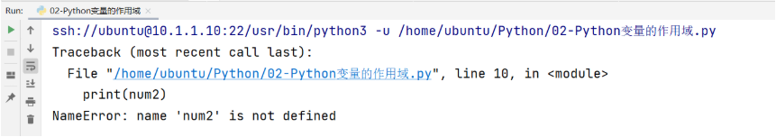
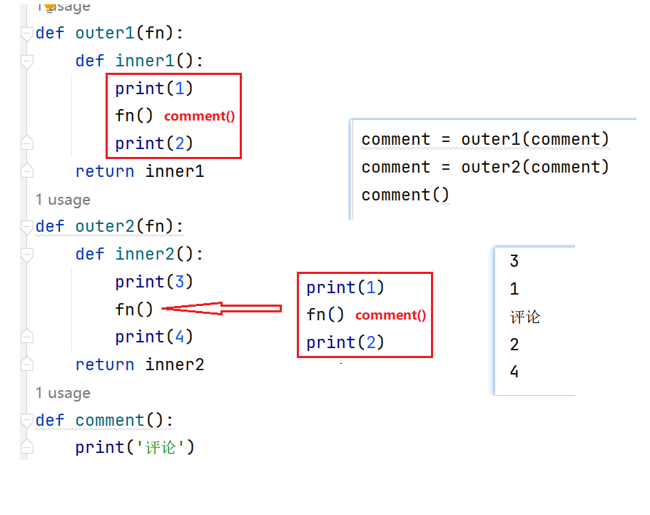

封装:将原来我们程序中变量和函数放在某个类中,如果需要使用,创建对象 然后调用

​	好处 : 更好维护

继承: 每个类 都可以继承特殊的类 , object是所有类的基类

​	好处:  子类可以拥有父类

多态: 同一个事物不同的形态,python没有真正意义上的多态 都是伪多态

## 一、全局变量和局部变量

### 1 作用域

在Python代码中，作用域分为两种情况：全局作用域 与 局部作用域

### 2 变量的作用域

在全局定义的变量 => 全局变量

在局部定义的变量 => 局部变量

### 3 全局变量与局部变量的访问范围

① 在全局作用域中可以访问全局变量，在局部作用域中可以访问局部变量

```
# 全局作用域（全局变量）
num1 = 10
def func():
    # 局部作用域（局部变量）
    num2 = 20
    # ① 在局部访问局部变量
    print(num2)

# ① 在全局访问全局变量
print(num1)
# 调用函数
func()
```

② 在局部作用域中可以访问全局变量

```
# 全局作用域（全局变量）
num1 = 10
def func():
    # 局部作用域（局部变量）
    # ② 在局部作用域中可以访问全局变量
    print(num1)

# 调用函数
func()
```

③ 在全局作用域中不能访问局部变量

```
# 全局作用域（全局变量）
num1 = 10
def func():
    # 局部作用域（局部变量）
    num2 = 20

# 调用函数
func()
# 在全局作用域中调用局部变量num2
print(num2)
```

运行结果：



### 4 问题：为什么在全局作用域中无法访问局部变量

gc机制

答：主要原因在于，在Python的底层存在一个“垃圾回收机制”，主要的作用就是回收内存空间。加快计算机的运行。我们在Python代码中定义的变量也是需要占用内存的，所以Python为了回收已经被使用过的内存，会自动将函数运行以后的内部变量和程序直接回收。


debug查看变量生命周期

```
def add(a, b):
    r = a + b
    return r
```


## 二、闭包

while 嵌套 for 嵌套 if嵌套

### 1 闭包的作用

函数嵌套: 至少两个函数, 一个叫外部函数 outer 一个叫内部函数inner

 在==函数嵌套==的前提下，内部函数==使用了外部函数的变量==，并且外部函数==返回了内部函数==，我们把这个使用外部函数变量的内部函数称为闭包。对象不会立即销毁

### 2 闭包的构成条件（三步走）

第一步：有嵌套(函数嵌套)

第二步：有引用(内部函数==使用了外部函数的变量==)

第三步：有返回(外部函数==返回了内部函数==)

语法:

```markdown

def 外部函数():
    # 局部变量
    def 内部函数():
        # 使用这个局部变量
    return 返回内部函数 
```


```
'''
闭包程序三步走：① 有嵌套 ② 有引用 ③ 有返回
'''

def outer():
    num = 20  # 局部变量
    def inner():
        print(num)
    return inner  # 实际上inner函数并没有执行，只是返回了inner函数在内存中的地址

f = outer()  # 相当于把inner在内存中的地址0x...赋值给变量f
f()  # 找到inner函数的内存地址，并执行器内部的代码（num=20)，在于闭包函数保留了num=20这个局部变量
```

闭包的作用：正常情况下，当执行outer()的时候，函数内部的变量num = 20，会随着函数的func函数的结束而被垃圾回收机制所回收。所以闭包的真正作用：就是可以在全局作用域中，实现间接对局部变量进行访问。(延迟销毁)

### 3 注意事项

注意点:

由于闭包引用了外部函数的变量，则外部函数的变量没有及时释放，消耗内存。

### 4 在闭包的内部实现对外部变量的修改

错误版本：

```
'''
Python闭包：① 有嵌套 ② 有引用 ③ 有返回
'''

def outer():
    num = 10
    def inner():
        # 这种写法无法实现通过闭包修改外部的局部变量
        num = 20
    print('outer函数中的num：', num)  # 10
    inner()  # 执行函数inner，让num=20生效
    print('outer函数中的num：', num)  # 10
    return inner

f = outer()
f()
```

正确版本：

新知识点：nonlocal关键字（在函数内部修改函数外部的变量，这个变量非全局变量）

老知识点：global关键字（在函数内部声明变量，代表引用全局作用域中的全局变量）

```
'''
Python闭包：① 有嵌套 ② 有引用 ③ 有返回
'''

def outer():
    num = 10
    def inner():
        #  num = 20 这种写法无法实现通过闭包修改外部的局部变量'
        nonlocal num
        num = 20
    print('outer函数中的num：', num)  # 10
    inner()  # 执行函数inner，让num=20生效
    print('outer函数中的num：', num)  # 20
    return inner

f = outer()
f()
```

### 5 闭包的综合案例

闭包的作用：可以在全局作用域中间接访问局部变量（在函数执行以后）

```
'''
闭包编写三步走：① 有嵌套 ② 有引用 ③ 有返回
分析：
执行f = func()的时候，result赋值为0，然后定义inner，返回inner，最终结果f = inner函数的内存地址
执行f(1)，相当于执行inner函数，nonlocal引用局部变量result=0，然后进行+1操作，弹出0+1=1
继续执行
执行f(2)，相当于执行inner函数，声明nonlocal result，代表还是引用外部的局部变量，由于此时外部的result已经被
f(1)更改为1了，所以由于局部变量一直没有消失，所以此时result=1，执行+2操作，最终结果为3
'''
def func():
    result = 0
    def inner(num):
        nonlocal result
        result += num
        print(result)
    return inner

f = func()
f(1)  # 1
f(2)  # 3
```

## 三、装饰器入门

装饰器是由闭包转换而来的

### 1 什么是装饰器

装饰器的代码为 @单词 (装饰器在其他的语言中也叫注解) @classmethod  @staticmethod

在不改变现有函数源代码以及函数调用方式的前提下，实现给函数增加额外的功能。

装饰器的本质就是一个闭包函数（三步：① 有嵌套 ② 有引用 ③ 有返回）

> 外部函数返回内部函数的地址值

### 2 装饰器的雏形-原始方式

```
# 要求：把登录功能封装起来（比如封装成一个函数，添加这个登录不能影响现有功能函数）
'''
装饰器：本质是一个闭包，有嵌套、有引用、有返回（返回的是函数的内存地址）
参数fn在check中也是一个局部变量
参数fn：就是要装饰的函数的函数名，如comment，如download
'''
def check(fn): #fn -> function 函数
    def inner():
        # 开发登录功能
        print('登录功能')
        # 调用原函数
        fn()
    return inner


# 评论功能（前提：登录）
def comment():
    print('评论功能')

comment = check(comment)
comment()

# 下载功能（前提：登录）
def download():
    print('下载功能')

download = check(download)
download()
```

### 3 装饰器定义-语法糖

```
'''
装饰器：本质就是一个闭包 ① 有嵌套 ② 有引用 ③ 有返回
'''
def check(fn):

    def inner():
        # 开发登录验证功能
        print('验证登录')
        # 执行原有函数
        fn()
    return inner

@check
def comment():
    print('发表评论')

comment()
```


### 4 企业开发中使用

1.创建一个py文件 文件中书写装饰器  例如文件名称: MyDecorator.py

```

import  time
from datetime import datetime
def log(fn):
    def inner():
        print(f"开始执行的时间为:{datetime.now()}")
        time.sleep(1) # 模拟以后程序运行耗时
        fn()  # fn指向就是外部传入的函数地址 如果要使用 就要加()  表示->调用外部传入的函数 原有函数  userinfo()
        print(f"结束执行的时间为:{datetime.now()}")
    return inner # 外层函数返回里层函数的地址
```

2.在需要使用装饰器的文件中 导入包  import 导入以后 直接使用语法糖方案即可

```
#from ProjectLog import  log    @方法名称 正常使用
# import ProjectLog             @ProjectLog.log 通过模块名称.方法名称
import ProjectLog as m #  取一个别名   @别名.方法名称
@m.log
def addOrder():
    print("添加一个新的订单")


addOrder()
```


### 5 装饰器的作用：获取程序的执行时间

编写一个函数该函数通过循环输出1000000 数字

编写一个装饰器 , 计算输出的函数执行时间

```
'''
定义获取程序的执行时间装饰器 => 闭包（① 有嵌套 ② 有引用 ③ 有返回）
'''
import time

def get_time(fn):
    def inner():
        # ① 添加装饰器修饰功能（获取程序的执行时间）
        begin = time.time()
        # ② 调用fn函数，执行原函数代码
        fn()
        end = time.time()
        print(f'这个函数的执行时间：{end - begin}')
    return inner


@get_time
def demo():
    for i in range(1000000):
        print(i)

demo()
```


### 扩展 6  嵌套装饰器

语法糖执行顺序:   由下往上装饰 , 由上往下运行


```markdown
原生装饰器装饰后的效果如下图
add = outer1(add) # 152
add = outer2(add) # 31524
代码的方式 自上而下
```




```python
# 13评论42  31评论24
def outer1(fn):
    def inner1():
        print(1)
        fn()
        print(2)
    return inner1
def outer2(fn):
    def inner2():
        print(3)
        fn()
        print(4)
    return inner2
# 装饰器与原生代码正好相反  代码自上而下运行  但是装饰顺序是自下而上
@outer1
@outer2
def comment():
    print('评论')


# 代码自上而下运行 先执行outer1的装饰 再执行outer2的装饰
#comment = outer1(comment)
#comment = outer2(comment)
comment()
```

## 四、装饰器进阶

### 1 函数带有参数使用装饰器

编写一个函数.传入 不定长元组参数和不定长字典参数.  将传入的参数计算总和

编写一个装饰器. 输出 '正在努力进行计算'

```python
import time


# 装饰器增强函数 记录时间
def logtime(fn):
    def inner( num1, num2): # 此处的参数对应的是 被增强方法的参数
        begin = time.time() # 记录开始
        fn( num1 , num2)   # 调用原来的函数
        end = time.time()  # 记录结束
        print(f'{fn.__name__}函数的执行时间是:{end - begin}')
    return inner

# 将传递的参数进行求和
@logtime
def num_sum(num1 , num2):
    print(num1+num2)

num_sum(10 , 20)


```


```
'''
带有参数的装饰器：① 有嵌套 ② 有引用 ③ 有返回
'''
def logging(fn):
    def inner(*args, **kwargs):
        # 添加装饰器代码（输出日志信息）
        print('-- 日志信息：正在努力计算机 --')
        # 执行要修饰的函数
        fn(*args, **kwargs)  # sum_num(a, b)
    return inner

@logging
def sum_num(*args, **kwargs):
    result = 0
    # *args代表不定长元组参数，args = (10, 20)
    for i in args:
        result += i
    # **kwargs代表不定长字典参数， kwargs = {a:30, b:40}
    for i in kwargs.values():
        result += i
    print(result)

# sum_num带4个参数，而且类型不同，10和20以元组形式传递，a=30，b=40以字典形式传递
sum_num(10, 20, a=30, b=40)
```


### 2 函数带有返回值使用装饰器

```python
import time


# 装饰器增强函数 记录时间
def logtime(fn):
    def inner( num1, num2): # 此处的参数对应的是 被增强方法的参数
        begin = time.time() # 记录开始
        temp_total = fn( num1 , num2)   # 调用原来的函数  此处注意 原功能函数有携带返回值 此处就需要接收返回值 本质就是原函数
        end = time.time()  # 记录结束
        print(f'{fn.__name__}函数的执行时间是:{end - begin}')
        return temp_total  # 等效 return num1+num2
    return inner

# 将传递的参数进行求和
@logtime
def num_sum(num1 , num2):
    return num1+num2

total = num_sum(10 , 20)
print(f'传入的参数总和为:{total}')


```


将上面的计算结果 通过返回值的方式 将计算结果返回

```
'''
带有返回值的装饰器：① 有嵌套 ② 有引用 ③ 有返回
如果一个函数执行完毕后，没有return返回值，则默认返回None
'''
def logging(fn):
    def inner(*args, **kwargs):
        print('-- 日志信息：正在努力计算 --')
        return fn(*args, **kwargs)  # fn() = sub_num(20, 10) = result
    return inner

@logging
def sub_num(a, b):
    result = a - b
    return result

print(sub_num(20, 10))
```

### 3 函数通用版本的装饰器(了解)

在装饰器函数中定义inner函数时, 加上不定长参数 *arg和**kwargs

```
'''
通用装饰器：① 有嵌套 ② 有引用 ③ 有返回 ④ 有不定长参数 ⑤ 有return返回值
'''
def logging(fn):
    def inner(*args, **kwargs):
        # 输出装饰器功能
        print('-- 正在努力计算 --')
        # 调用fn函数
        return fn(*args, **kwargs)
    return inner


@logging
def sum_num1(a, b):
    result = a + b
    return result

print(sum_num1(20, 10))

@logging
def sum_num2(a, b, c):
    result = a + b + c
    return result

print(sum_num2(10, 20, 30))
```


```python

# 模版代码
# 我们需要做的事情 1.修改外部函数的名称
# 2.在第  result = fn( *args ,**kwargs ) 这行代码的前后写我们的增强代码
# 1.有嵌套 2.有引用 3.有返回值
def outer(fn): # fn 被增强的函数
    def inner(*args , **kwargs):  #1.有嵌套
        # 书写我们自己的逻辑代码

        result = fn( *args ,**kwargs ) # 接收被增强函数的返回值
        # 书写我们自己的逻辑代码

        return result  # 返回数据
    return inner  #3.有返回值

#在函数的上方加上@装饰名称
```


### 4 装饰器高级：使用装饰器传递参数（了解）

如果我们需要在装饰器上再增加参数 那么我们需要 在增强的代码上再套一层

基本语法：

```
def 装饰器(装饰器参数):
    def 外部函数():
        # 局部变量
        def 内部函数():
            print(num)
    return 返回内部函数 

@装饰器('参数')
def 函数():
    # 函数代码
```

实例代码：根据传递参数不同，打印不同的日志信息

```python
'''
通用装饰器：① 有嵌套 ② 有引用 ③ 有返回 ④ 有不定长参数 ⑤ 有return返回值
真正问题：通过装饰器传递参数，我们应该如何接收这个参数呢？
答：在logging方法的外侧在添加一个函数，专门用于接收传递过来的参数
'''

def logging(flag):
    # flag = + 或 flag = -
    def decorator(fn):
        def inner(*args, **kwargs):
            if flag == '+':
                print('-- 日志信息：正在努力进行加法运算 --')
            elif flag == '-':
                print('-- 日志信息：正在努力进行减法运算 --')
            return fn(*args, **kwargs)
        return inner
    return decorator

@logging('+')
def sum_num(a, b):
    result = a + b
    return result

@logging('-')
def sub_num(a, b):
    result = a - b
    return result


print(sum_num(10, 20))
print(sub_num(100, 80))
```


原生代码

```python

def outer(fn):
    def inner(num1,num2 , flag):# 根据传入的参数不一样  输出日志 例如: 正在执行加法运算 或者 正在执行减法运算
        if flag =="+":
            print("正在执行加法运算")
        else:
            print("正在执行减法运算")
        result = fn(num1 , num2)
        return result
    return inner

# 传入两个参数 进行相加
def my_sum(num1 , num2):
    sum = num1+num2
    return sum

# 传入两个参数 进行相减
def my_sub(num1 , num2):
    sub = num1-num2
    return sub
my_sum =  outer(my_sum)
result1 = my_sum(10,5 , "+")
print(result1)
my_sub =  outer(my_sub)
result2= my_sub(10,5 , "-")
print(result2)
```


# 五、案例

案例一：定义两个装饰器 ，分别是登陆功能和验证码功能，再发布评论的时候，为发布评p论添加多个额外功能


案例二：定义一个既能装饰减法运算，又能装饰加法运算的装饰器


常规写法:

```
# 定义一个既能装饰减法运算又能装饰加法运算装饰器


def out_fn(fn, flag):
    def inner_fn(a, b):
        if flag == '+':
            print('正在执行加法运算...')
        if flag == '-':
            print('正在执行减法运算...')
        result = fn(a, b)
        return result

    return inner_fn


def add(m, n):
    return m + n


def diff(m, n):
    return m - n


#add = out_fn(add, "+")
result1 = add(5, 3)
print(result1)

#diff = out_fn(diff, "-")
result2 = diff(5, 3)
print(result2)

```


语法糖

```
# 定义一个既能装饰减法运算又能装饰加法运算装饰器

def flag_fn(flag):
    def out_fn(fn):
        def inner_fn(a, b):
            if flag == '+':
                print('正在执行加法运算...')
            if flag == '-':
                print('正在执行减法运算...')
            result = fn(a, b)
            return result

        return inner_fn
    return out_fn

@flag_fn('+')
def add(m, n):
    return m + n


@flag_fn('-')
def diff(m, n):
    return m - n


# add = out_fn(add, "+")
result1 = add(5, 3)
print(result1)

# diff = out_fn(diff, "-")
result2 = diff(5, 3)
print(result2)

```


# 课后案例: 

使用装饰器统计一个函数被调用了多少次

正数计算器:  编写一个函数计算num1+num2的值, 要求num1和num2必须是正整数(使用装饰器完成)