# 1. 数据库概述

## 学习目标

知道什么是数据库

知道关系型数据库和非关系型数据库的区别

## **1.1 什么是数据库？**

简单来说，**数据库就是一个有组织、可高效访问和管理的电子化数据集合**。

我们可以用一个形象的比喻来理解：

- **文件柜 vs. 数据库**：一个装满杂乱无章文件的文件柜，找一份文件非常困难。而数据库就像一个智能文件柜，它不仅把所有文件（数据）分门别类地放好，还有一个专业的图书管理员（数据库管理系统）帮你快速找到、添加、修改或删除任何你需要的文件。

**官方定义**：数据库是长期存储在计算机内、有组织的、可共享的、统一管理的海量数据的集合。

## **1.2 为什么需要数据库？**

在没有数据库的时代，数据通常存储在文件（如txt、excel、csv）中，但这会带来诸多问题：

1. **数据冗余与不一致性**：相同的数据可能在多个文件中重复存储，且更新时容易产生不一致。
2. **数据访问困难**：需要编写复杂的程序来查找特定数据，效率低下。
3. **数据孤立性**：数据分散在不同格式的文件中，难以关联和整合。
4. **并发访问异常**：多个用户同时读写同一文件时，数据容易损坏。
5. **安全问题**：难以精细化控制不同用户对数据的访问权限。

**数据库的出现，正是为了解决上述所有问题。**

## **1.3  数据库的核心组件**

我们通常所说的“数据库”其实包含两个核心部分：

**数据库本身**

- 即实际存储数据的“仓库”，通常是一个或多个文件。

**数据库管理系统**

- **DBMS** 是一种操纵和管理数据库的大型软件，用于建立、使用和维护数据库。它是用户（或应用程序）与数据库之间的接口。
- **常见的DBMS**：**MySQL, Oracle,SQL Server, db2...** 等。

用户和应用程序通过 **DBMS** 来访问和操作数据库，而不是直接操作数据文件。

## **1.4 数据库分类** 

数据库根据其组织数据的方式可以分为不同类型，其中最主要的两类是：

数据库根据其组织数据的方式（数据模型）可以分为多种类型，其中最主要的两类是：

**关系型数据库**

- **概念**：将数据组织成一系列**二维表**（由行和列组成），表与表之间存在关系。
- **核心术语**：
- **表**：存储特定类型数据的结构。
- **行/记录**：表中的一条具体数据。
- **列/字段**：数据的某个属性（如姓名、年龄）。
- **主键**：唯一标识一条记录的字段。
- **外键**：建立表与表之间关系的字段。
- **查询语言**：**SQL**，这是一种声明式语言，你只需要告诉数据库“想要什么”，而不需要关心“如何获取”。
- **优点**：ACID特性（原子性、一致性、隔离性、持久性）保证数据强一致性、成熟稳定。
- **代表**：**MySQL, Oracle, PostgreSQL, SQL Server, SQLite**。

**非关系型数据库**

- **概念**：为了应对互联网时代海量、多样、高速的数据处理需求而诞生。它没有固定的表结构，数据模型灵活。
- **主要类型**：
- **键值型**：简单的键值对存储（如Redis）。
- **文档型**：数据存储为类似JSON的文档（如MongoDB）。
- **列族型**：按列存储数据，适合大数据分析（如HBase）。
- **图数据库**：存储实体（节点）和它们之间的关系（边），适合社交网络、推荐系统（如Neo4j）。
- **优点**：灵活、可扩展性强、读写性能高。
- **代表**：**Redis, MongoDB, Hbase, Neo4j**。

## **1.5 数据库的应用**

**选择 SQL 还是 NoSQL**，不是一个谁更好的问题，而是一个 **“更适合”** 的问题。

- 当你需要构建一个**关键业务系统**（如银行、电商、ERP），其中**数据的准确性和一致性是生命线**，并且业务逻辑复杂、涉及大量关联查询时，**SQL 数据库是毋庸置疑的首选**。
- 当你需要处理**海量非结构化数据**、要求**极高的写入速度**和**无限的水平扩展能力**（如日志记录、社交媒体的动态流、物联网传感器数据），并且可以接受最终一致性时，**NoSQL 数据库是更好的选择**

数据库是现代信息系统的核心，无处不在：

- **电子商务**：存储商品、用户、订单信息。
- **银行系统**：管理账户、交易记录。
- **社交网络**：存储用户资料、好友关系、动态信息。
- **物联网**：收集和处理海量传感器数据。
- **企业ERP系统**：整合企业的人力、财务、供应链等数据。

------

**简单来说，数据库是现代数字世界的基石，它以一种可靠、高效和安全的方式，帮助我们存储和管理日益增长的数据资产。** 理解数据库的基本概念是进入软件开发、数据分析等领域的必备第一步。


# 2 关系型数据库 MySQL

## 2.1、SQL语言

### 2.1.1 SQL简介

```
SQL: 结构化查询语言, 是所有关系型数据库都要遵循的规范

大白话解释: 可以理解成sql是普通话,mysql,oracle等是方言
```

### 2.1.2 SQL分类

官方定义四种 DDL DML DCL TCL  DQL(不属于官方定义) 约定俗成 

```
DDL: 数据定义语言:简称DDL(Data Definition Language)
        作用: 用来定义数据库对象：数据库，表，列/字段等。  结构
        关键字: create，drop，alter等   关心: 如何创建库  如何创建表

DML: 数据操作语言:简称DML(Data Manipulation Language)
        作用:用来对数据库中表的记录进行更新。  
        关键字: insert，delete，update等  关心: 增删改 数据

DQL: 数据查询语言:简称DQL(Data Query Language) -程序员自定义的
        作用:用来查询数据库中表的记录。
        关键字: select，from，where等    主要就是查询

DCL: 数据控制语言：简称DCL(Data Control Language)
        用来定义数据库的访问权限和安全级别，及创建用户。
TCL: 数据库的事务语言
```

### 2.1.3 SQL通用语法

```
1、SQL语句可以单行或多行书写，以分号结尾。  
        举例: select *  from 表名 where 条件;

2、可使用空格和缩进来增强语句的可读性 可以加入很多空格 回车 换行
        select *  
        from 表名 
        where 条件;

3、MySQL数据库的SQL语句不区分大小写，关键字建议使用大写
        例如:select *  from 表名 where 条件; SELECT * FROM 表名 WHERE 条件;
        大小写切换快捷键: ctrl+shift+u

4、可以使用 /**/，-- ，# 的方式完成注释
        /**/:多行注释，在注释区域内可以随意换行
        -- 和 # :单行注释，写在语句开头，换行后注释截止。注意: --的后面必须有一个空格
        单行注释快捷键: ctrl+/         
        多行注释快捷键: ctrl+shift+/
```

## 2.2、MySQL数据库连接

> MySQL是最好的 RDMS (Relational Database Management System，关系数据库管理系统) 应用软件，目前属于 Oracle 旗下产品，MySQL 是最流行的关系型数据库管理系统中的一个
>
> 本次课程使用MySQL8.0版本， MySQL Community Server进行学习

### 2.2.1 命令连接

cmd操作,如果不配置环境变量 提示 mysql不是内部或外部命令

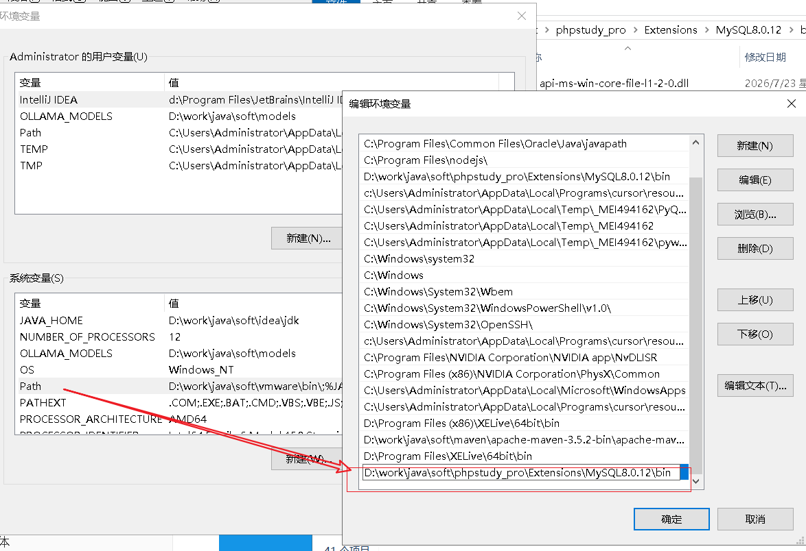

```
登录: u username  p password  h host 
    方式1: mysql -u用户名 -p密码
    方式2: mysql -u用户名 -p 回车后再输入密码
    方式3: mysql -h主机地址 -p 回车后再输入密码
    注意: localhost默认代表本地主机,或者127.0.0.1也代表本机

登出: 
    方式1: exit
    方式2: quit
    方式3: \q
    注意: 在mac/linux中使用ctrl+d/ctrl+c也能退出
```

### 2.2.2 工具连接

#### 2.2.2.1 连接mysql服务

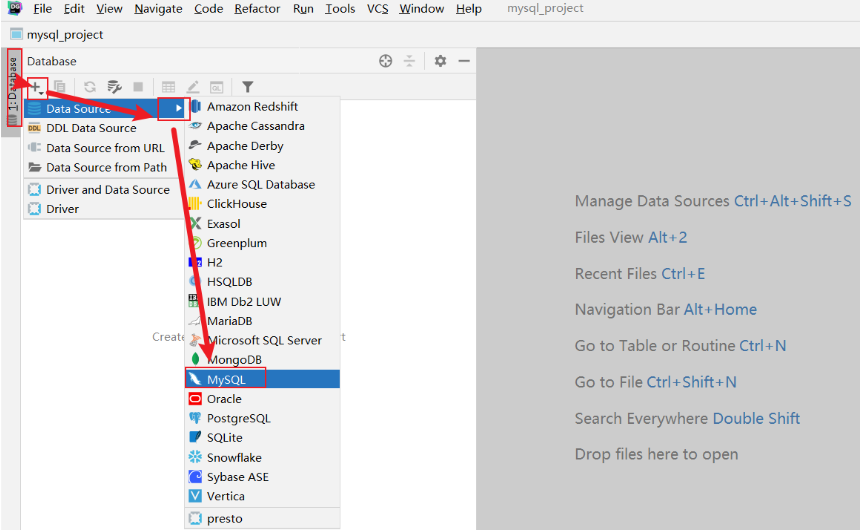

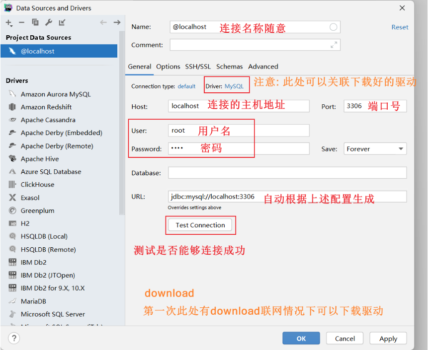

#### 2.2.2.1 关联驱动

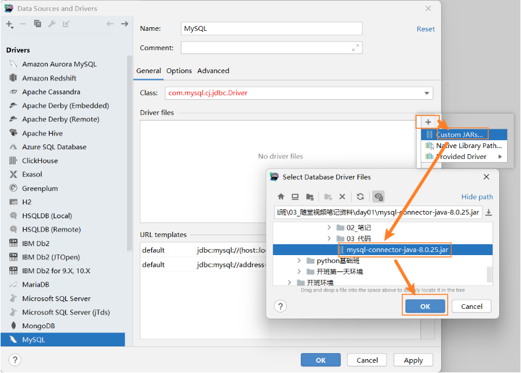

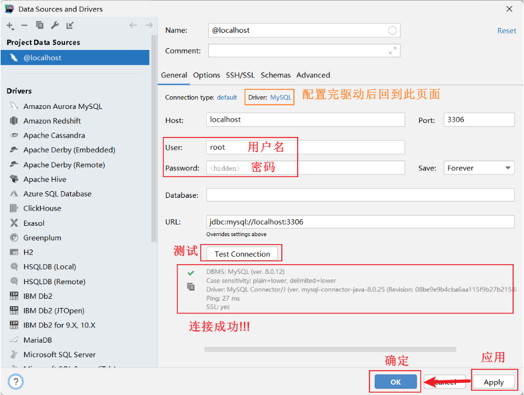

### 2.3 工具设置

#### 3.1 字体

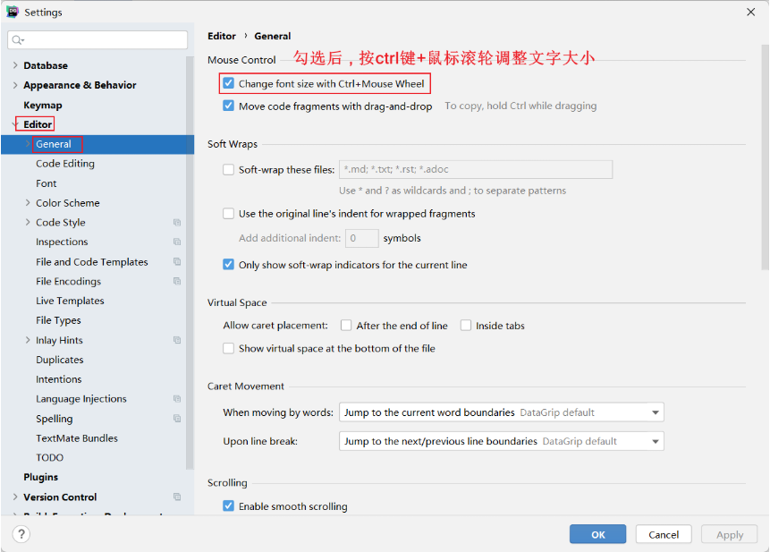

#### 3.2 主题

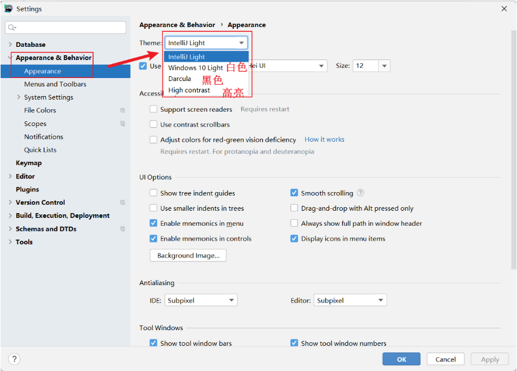

#### 3.3 mysql相关

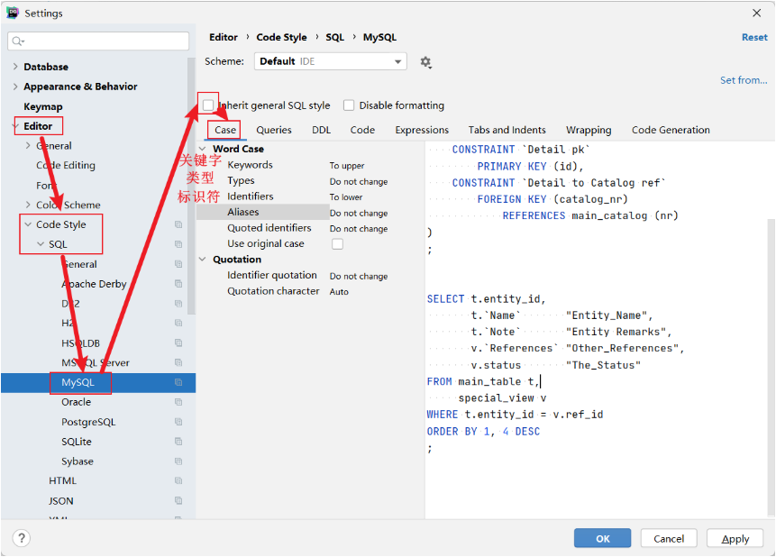

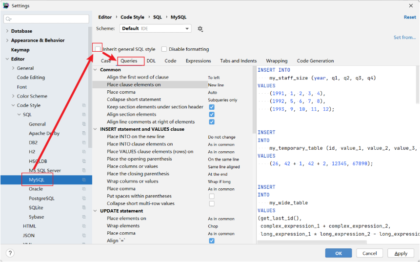


#### 3.4 方言

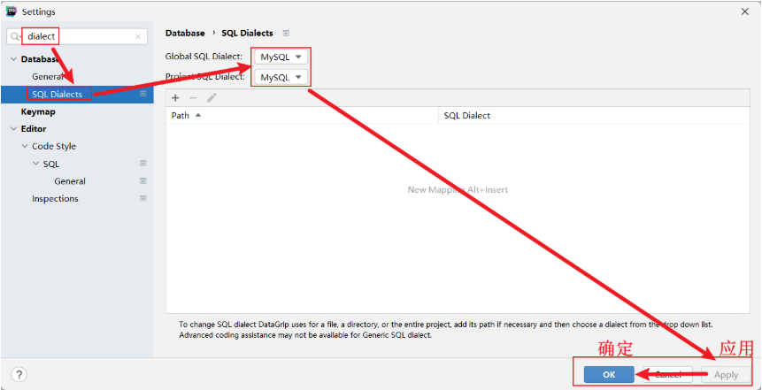

## 3、MySQL操作

### 3.1 数据库核心操作

> 数据库英文单词: database

#### 知识点

```
创建数据库: create database [if not exists] 数据库名;  

使用/切换数据库: use 数据库名;

查看所有的数据库名: show databases;
```

#### 示例:

```
# 一.数据库的增删改查
# 1.创建数据库:
create database test;
create database test; # 报错,因为test已经存在
# if not exists: 如果库不存在就创建,存在就忽略
create database test1;
create database IF NOT EXISTS test1; # 存在忽略
create database IF NOT EXISTS test2; # 不存在就创建
# character set utf8: 设置编码为utf8,注意: mysql大多数版本已经都默认utf8
create database test3 CHARACTER SET utf8;
create database test4 CHARSET utf8;

# 2.切换数据库:
use test;

# 3.查看所有库:
show databases;
```

### 3.2 数据类型和约束

#### 数据类型

```
字符串类型: varchar(字符长度)-可变长字符 char(字符长度)-固长字符
varchar(10) ->  输入111 占据长度就是 3
char(10)    ->  输入111 占据长度就是 10  , 3位固定长度 7位的空格

整数类型: int    注意: 默认长度是11,如果int不够用就用bigint

浮点类型: float(python默认) 或者 double(java默认)   decimal(默认是有效位数是10,小数后位数是0)
decimal(11 , 2) 参数1 表示长度(包含小数+整数) 参数2小数位

日期时间: date  datetime  year
```

#### 数据约束

```
主键约束: primary key    特点: 修饰列对应的值非空唯一   

主键自增: auto_increment 特点: 修饰主键对应的值不指定主键字段或者用0和null占位代表自动使用自增

非空约束: not null       特点: 修饰列对应的值不能为空

唯一约束: unique         特点: 修饰列对应的值不能重复

默认约束: default        特点: 修饰列对应的值提前设置默认值

外键约束: FOREIGN KEY    特点: 保证数据的完整性:限制从表插入数据,同时也限制主表删除数据
```

### 3.3 库中表核心操作

> 表的英文单词: table

#### 知识点:

```
创建表: create table  表名(字段名 字段类型 [字段约束] , 字段名 字段类型 [字段约束] ...);

查看所有表: show tables;
```

#### 示例:

```
# 创建my_db数据库
create database my_db;
# 使用my_db库
use my_db;
# 操作表的前提: 先创建库,并使用它
# 需求:创建学生表,用于存储学生的姓名,年龄,身高,生日信息
create table student(
    id int,
    name VARCHAR(100),
    age int,
    height float,
    birthday date
);
```

### 3.4 表中记录增删改-DML

#### 知识点:

```
插入数据记录: insert into 表名 (字段名...) values (具体值...) , (具体值...);   
            注意1: 具体值要和前面的字段名以及顺序一一对应上
            注意2: 如果要插入的是所有字段,那么字段名可以省略(默认代表所有列都要插入数据)
            注意3: 如果要插入多条记录,values后多条数据使用 逗号 分隔

修改数据记录: update 表名 set 字段名=值 [where 条件];
            注意: 如果没有加条件就是修改对应字段的所有数据

删除数据记录: delete from 表名 [where 条件];
            注意: 如果没有加条件就是删除所有数据

清空所有数据:
    方式1: delete from 表名;   注意:delete删除所有数据,自增顺序保留,下次再插入的时候继续自增
    方式2: truncate [table] 表名;  注意:truncate删除所有数据,自增顺序重置,下次再插入数据的时候从1重新开始自增
```

#### 示例:

```
/*
操作库的前提: 先启动mysql服务,并连接它
操作表的前提: 先有库,并使用它
操作数据的前提: 先有表,并有对应字段
*/
# 创建库
create database my_db;
# 使用库
use my_db;
# 创建表
create table student(
    id int,
    name VARCHAR(100),
    age int
);
# 插入数据
# 指定字段插入一条数据
insert into student(name) values ('张三');
# 指定字段插入多条数据
insert into student(name) values ('李四'),('王五'),('赵六');
# 注意: 不指定字段本质代表指定所有字段
# 不指定字段插入一条数据
insert into student values (1,'张三',18);
# 不指定字段插入多条数据
insert into student values (1,'张三',18),(2,'李四',18),(3,'王五',18);


# 修改数据
# 修改李四的年龄为28
update student set age = 28 where name = '李四';
# 修改王五和赵六的年龄为39
update student set age = 39 where name = '王五' or name = '赵六';
# 修改赵六的id为4,年龄为40
update student set id = 4,age = 40 where name = '赵六';
# 注意: 如果没有加条件,修改的是所有数据(慎用!!!)
update student set age = 12; # 报黄警告!然后弹窗警告,如果非要执行,选择execute


# 删除数据
# 删除id为1的记录
delete from student where id = 1;
# 删除id为1,以及id为3的记录
delete from student where id = 2 or id = 3;
# 注意: 如果不加条件删除的是所有数据(慎用!!!)
delete from student; # 报黄警告!然后弹窗警告,如果非要执行,选择execute

# 为了演示truncate删除数据,重新插入多条
insert into student values (1,'张三',18),(2,'李四',18),(3,'王五',18);
# truncate也能删除所有数据
truncate table student; 
```


约束代码

```sql

/*
    数据库如果没有更多的约束情况 数据无法进行区分
    数据库有可能存在一模一样的数据
    需要为数据库添加一定的约束情况, 约束: 限制
    id : 数据库中用于表示数据身份 唯一(相当于人的身份证)
    主键约束 : 唯一+非空 primary key
        主键=唯一+非空
        如果这个字段是主键 并且 是整型的情况下 可以为其添加 自增属性
        有了自增属性以后 我们不需要关键主键的事情 auto_increment
        唯一+非空不等于主键
    数据库表中 一个表只能存在一个主键
    唯一约束 : 只能出现一次 unique
    非空约束 : 不能为空值 not null
    默认值约束 : 当我们没有添加数据的时候 默认自己添加的数据  default
*/
create table s2(
    id int ,
    name varchar(12), # 这个人的真实姓名
    username varchar(12) unique, # 账号
    height float,
    gender varchar(1)
);
# 测试唯一  Duplicate entry 'zhangsan' for key 'username'  唯一重复
insert into s2 values(2, '张三' ,'zhangsan',173 , '男');

create table s3(
    id int ,
    name varchar(12) not null, # 这个人的真实姓名
    username varchar(12) unique, # 账号
    height float,
    gender varchar(1)
);
# 测试非空  Column 'name' cannot be null  name列不可以为空
insert into s3 values(1, null ,'zhangsan',173 , '男');


create table s4(
    id int primary key,
    name varchar(12) not null, # 这个人的真实姓名
    username varchar(12) unique, # 账号
    height float,
    gender varchar(1)
);
# Duplicate entry '1' for key 'PRIMARY'  主键唯一重复
insert into s4 values(1, '张三' ,'zhangsan',173 , '男');
# Column 'id' cannot be null  id 列不可以为空
insert into s4 values(null, '张三' ,'zhangsan',173 , '男');
# 主键必须保证唯一+非空

create table s5(
    id int primary key auto_increment,
    name varchar(12) not null, # 这个人的真实姓名
    username varchar(12) unique, # 账号
    height float,
    gender varchar(1)
);
insert into s5 values(null, '张三' ,'zhangsan',173 , '男');
# 数据库会自己管理主键 跟我们无关
insert into s5 values(null, '张三2' ,'zhangsan2',173 , '男');


create table s6(
    id int primary key auto_increment,
    name varchar(12) not null, # 这个人的真实姓名
    username varchar(12) unique, # 账号
    height float default null,
    gender varchar(1) default '男'
);
# 默认值约束 : 当我们没有添加这个字段值的时候 使用默认值
insert into s6(id,name,username,height) values(null, '张三2' ,'zhangsan2',173 );
```


## 4、单表查询

### 4.1 准备数据

```
# 创建数据库: create database 库名;
CREATE DATABASE IF NOT EXISTS my_db CHARSET=utf8;

# 使用数据库: use 库名;
USE my_db;

# 创建表: create table 表名(字段名 字段类型 [约束],...);
# 建测试表
drop table if EXISTS products;
CREATE TABLE IF NOT EXISTS products
(
    id          INT PRIMARY KEY AUTO_INCREMENT, -- 商品ID
    name        VARCHAR(24)    NOT NULL,        -- 商品名称
    price       DECIMAL(10, 2) NOT NULL,        -- 商品价格
    score       DECIMAL(5, 2),                  -- 商品评分，可以为空
    is_self     VARCHAR(8),                     -- 是否自营
    category_id INT                             -- 商品类别ID
);

drop table if EXISTS category;
CREATE TABLE IF NOT EXISTS category
(
    id   INT PRIMARY KEY AUTO_INCREMENT, -- 商品类别ID
    name VARCHAR(24) NOT NULL            -- 类别名称
);

# 插入数据: insert into 表名 (字段名,字段名) values(字段值,字段值),(字段值,字段值);
# 添加测试数据
INSERT INTO category
VALUES (1, '手机'),
       (2, '电脑'),
       (3, '美妆'),
       (4, '家居');

INSERT INTO products
VALUES (1, '华为Mate50', 5499.00, 9.70, '自营', 1),
       (2, '荣耀80', 2399.00, 9.50, '自营', 1),
       (3, '荣耀80', 2199.00, 9.30, '非自营', 1),
       (4, '红米note 11', 999.00, 9.00, '非自营', 1),
       (5, '联想小新14', 4199.00, 9.20, '自营', 2),
       (6, '惠普战66', 4499.90, 9.30, '自营', 2),
       (7, '苹果Air13', 6198.00, 9.10, '非自营', 2),
       (8, '华为MateBook14', 5599.00, 9.30, '非自营', 2),
       (9, '兰蔻小黑瓶', 1100.00, 9.60, '自营', 3),
       (10, '雅诗兰黛粉底液', 920.00, 9.40, '自营', 3),
       (11, '阿玛尼红管405', 350.00, NULL, '非自营', 3),
       (12, '迪奥996', 330.00, 9.70, '非自营', 3);
```

### 4.2 基础查询

#### 知识点:

```
基础查询关键字: select:查什么    from: 从哪儿查

基础查询格式:  select [distinct] 字段名 | * from 表名;
             []:可以省略
              |: 或者
              *: 对应表的所有字段名
              distinct: 去除重复内容
              as  : 可以给表或者字段起别名
```

#### 示例:

```
-- 需求1: 查看所有商品
select * from products;
-- 需求2: 查看所有商品的名称和价格
select name,price from products;
-- 需求3: 查看所有商品的名称和价格,要求给字段名起别名展示
select name as 姓名,price as 价格 from products;
select name  姓名,price  价格 from products;
-- 需求4: 查看所有商品的名称和价格,要求给表名起别名并使用
select products.name,products.price from products;
-- 如果给表起了表名,必须用别名调用字段
select p.name,p.price from products as p;
select name,price from products as p;
-- 需求5: 查看所有的分类编号,要求去重展示
select DISTINCT category_id from products;
```

### 4.3 条件查询

#### 知识点:

```
条件查询关键字:  where 

条件查询基础格式: select 字段名 from 表名 where 条件;

              比较运算符: >  <  >=  <=  !=  <>

              逻辑运算符: and  or  not

              范围 查询: 连续范围:between x and y       非连续范围: in(x,y)

              模糊 查询: 关键字:like   %:0个或者多个字符   _:一个字符

              非空 判断: 为空: is null    不为空:is not null
```

#### 比较查询

```
# 1.比较运算符: >  <  >=  <=  !=  <>

-- 需求1: 查询所有'自营'的商品
select * from products where is_self = '自营';
-- 需求2: 查询评分在'9.50'(不含)以上的商品
select * from products where score > 9.50;
-- 需求3: 查询评分在'9.50'(含)以上的商品
select * from products where score >= 9.50;
-- 需求4: 查询价格在999(不含)以下的商品
select * from products where price < 999;
-- 需求5: 查询价格在999(含)以下的商品
select * from products where price <= 999;
-- 需求6: 查询评分不等于9.30的商品
select * from products where score != 9.3;
select * from products where score <> 9.3;
```

#### 逻辑查询

```
-- and: 并且  or:或者  not:取反

-- 需求1: 查询自营商品中所有价格大于2000的商品信息
select * from products where is_self = '自营' and price > 2000;
-- 需求2: 查询商品评分在9.0(含)-9.5(含)之间的商品信息
select * from products where score >= 9 and score <= 9.5;
-- 需求3: 查询商品价格在1000(含)到3000(含)之间的商品信息
select * from products where price >= 1000 and price <= 3000;
-- 需求4: 查询价格是999或者2199或者2399的商品
select * from products where price = 999 or price = 2199 or price = 2399;
-- 需求5: 查询商品是'华为Mate50'或者'荣耀80'的商品
select * from products where name = '华为Mate50' or name = '荣耀80';
-- 需求6: 查询商品不是自营的商品
select * from products where not is_self = '自营';
select * from products where  is_self = '非自营';
-- 需求7: 查询商品不在1000到3000之间的商品
select * from products where not (price >= 1000 and price <= 3000);
select * from products where  price < 1000 or price > 3000;
```

#### 范围查询

```
-- 需求1: 查询商品价格在1000(含)到3000(含)之间的商品信息
select * from products where  price BETWEEN 1000 and 3000;
-- 注意: 以下语法是错误的
select * from products where 1000 <= price <= 3000;
-- 需求2: 查询商品不在1000到3000之间的商品
select * from products where  price not BETWEEN 1000 and 3000;
-- 需求3: 查询价格是999或者2199或者2399的商品
select * from products where price in(999,2199,2399);
-- 需求4: 查询商品是'华为Mate50'或者'荣耀80'的商品
select * from products where name in('华为Mate50','荣耀80');
```

#### 模糊查询

```
-- 关键字: like   符号 %:任意多个字符  _:任意1个字符

-- 需求1: 查询商品名称以'华'开头的商品信息
select * from products where name like '华%';
-- 需求2: 查询商品名称以'华'开头并且8个字符的商品信息
select * from products where name like '华_______';
-- 需求3: 查询商品名称以'66'结尾商品信息
select * from products where name like '%66';
-- 需求4: 查询商品名称中包含'兰'字的商品信息
select * from products where name like '%兰%';
-- 需求5: 查询商品名称中第3个字是'兰'字的商品信息
select * from products where name like '__兰%';
```

#### 非空判断

```
/*
null在sql中代表空的,没有任何意义的意思
如果数据中有空字符串'',字符串'null',一定要注意,他们和sql中的null不是一回事!!!
*/
-- 需求1:查询未评分的商品信息
select * from products where score is null;
-- 注意: 以下方式是错误的
select * from products where score = null;
select * from products where score = '';
select * from products where score = 'null';
select * from products where score is 'null';

-- 为了方便演示null和'','null'的区别,可以插入部分测试数据
insert into products(name,price) values('拯救者Y9000','9999');
insert into products(name,price) values('null','99');
insert into products(name,price) values('',0);

-- 需求2:查询商品名称是'null'的商品信息
select * from products where name = 'null';
-- 需求3:查询商品名称是''的商品信息
select * from products where name = '';
```

### 4.4 排序查询

#### 知识点:

```
排序查询关键字: order by

排序查询基础格式: select 字段名 from 表名 order by 排序字段名 asc|desc;
            asc : 升序(默认)
            desc: 降序

排序查询进阶格式: select 字段名 from 表名 order by 排序字段1名 asc|desc , 排序字段2名 asc|desc;
            注意: 如果order by后跟多个排序字段,先按照前面的字段排序,如果有相同值的情况再按照后面的排序规则排序
```

#### 示例:

```
-- 示例1：查询所有商品，并按照评分从高到低进行排序
SELECT * FROM products ORDER BY score DESC;

-- 示例2：查询所有商品，先按照评分从高到低进行排序，评分相同的再按照价格从低到高排序
SELECT * FROM products ORDER BY score DESC, price;
```

### 4.5 聚合函数

#### 知识点:

```
聚合函数: 又叫统计函数,也叫分组函数

常用聚合函数:  sum()  count()  avg()   max()  min()

聚合查询基础格式: select 聚合函数(字段名) from 表名;    注意: 此处没有分组默认整个表就是一个大的分组

注意: 聚合函数(字段名)会自动忽略null值,以后统计个数一般用count(*)统计因为它不会忽略null值
```

#### 示例:

```
# 注意: 别名不建议用中文,以下仅仅为了演示
-- 示例1：统计当前商品一共有多少件
SELECT count(id) FROM products;
SELECT count(*) FROM products;

-- 示例2：对商品评分列进行计数、求最大、求最小、求和、求平均
SELECT
    COUNT(score) AS cnt,
    MAX(score) AS max_score,
    MIN(score) AS min_score,
    SUM(score) AS total_score,
    AVG(score) AS avg_score
FROM products;


-- 示例3：统计所有非自营商品评分的平均值
SELECT
    is_self,
    AVG(score)
FROM
    products
WHERE
    is_self = '非自营';
```

### 4.6 分组查询

#### 知识点:

```
分组查询关键字: group by

分组查询基础格式: select 分组字段名,聚合函数(字段名) from 表名 group by 分组字段名;

注意: select后的字段名要么在group by后面出现过,要么写到聚合函数中,否则报错...sql_mode=only_full_group_by

分组查询进阶格式: select 分组字段名,聚合函数(字段名) from 表名 [where 非聚合条件] group by 分组字段名 [having 聚合条件];

where和having的区别? 
    书写顺序: where在group by 前,having在group by后
    执行顺序: where在分组前,having在分组后
    分组函数: where后不能跟聚合条件,只能跟非聚合条件,having后可以使用聚合条件,也可以使用非聚合条件(不建议)
    应用场景: 建议大多数过滤数据都采用where,只有当遇到聚合条件的时候再使用having
    使用别名: where后不能使用别名,having后可以使用别名
```

#### 示例:

```
-- 示例1：统计每个分类的商品数量
SELECT
    category_id,
    -- ② 再聚合：对每一组的id进行count计数
    COUNT(id) AS cnt
FROM products
-- ① 先分组：按照category_id进行分组
GROUP BY category_id;


 
SELECT
    category_id,
    is_self,
    COUNT(id) AS cnt
FROM products
GROUP BY category_id, is_self;


-- 示例3：统计每个分类商品的平均价格，并筛选出平均价格低于1000的分类
SELECT category_id,
       -- 再聚合
       AVG(price)
FROM products
-- 先分组
GROUP BY category_id
-- 对分组聚合的结果进行筛选
HAVING AVG(price) < 1000;
```

### 4.7 limit查询

#### 知识点:

```
分页查询关键字: limit

分页查询基础格式: select 字段名 from 表名 limit x,y;
            x: 起始索引,默认从0开始     x = (页数-1)*y
            y: 本次查询的条数

注意: limit能完成topN需求,但是不能考虑到并列情况,此问题可以使用后期学习的开窗函数解决
```

#### 示例:

```
- 示例1：获取所有商品中，价格最高的商品信息
SELECT
    *
FROM products
ORDER BY price DESC
LIMIT 1; -- LIMIT 0, 1;


-- 示例2：将商品数据按照价格从低到高排序，然后获取第2页内容（每页3条）
SELECT
    *
FROM products
ORDER BY price
LIMIT 3, 3;

-- 示例3：当分页展示的数据不存在时，不报错，只不过查询不到任何数据
SELECT * FROM products LIMIT 20, 10;
```

### 4.8 SQL顺序

>select distinct  字段 | * | 聚合函数 as 别名 from 表 where group by   having  order by  limit

```
书写顺序: SELECT -> DISTINCT -> 聚合函数 -> FROM -> WHERE -> GROUP BY -> HAVING -> ORDER BY -> LIMIT
执行顺序: FROM -> WHERE -> GROUP BY -> 聚合函数 -> HAVING -> SELECT -> DISTINCT -> ORDER BY -> LIMIT
```

## 5、多表查询

> 本质: 把多个表通过主外键关联关系连接(join)合并成一个大表,再去查询

### 5.1 多表关系

一对一 : 一个人一个身份证号

**一对多**: 一个分类下有多个商品

多对多: 课程和学生 一般要借助中间表,把多对多变成一对多

### 5.2 外键

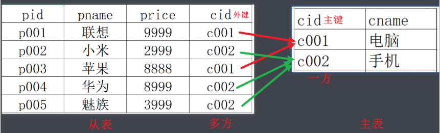

```
外键概念: 在从表(多方)创建一个字段，引用主表(一方)的主键,对应的这个字段就是外键。

外键特点：
    1:从表外键的值是对主表主键的引用。
    2:从表外键类型，必须与主表主键类型一致。
```

### 5.3 连接查询

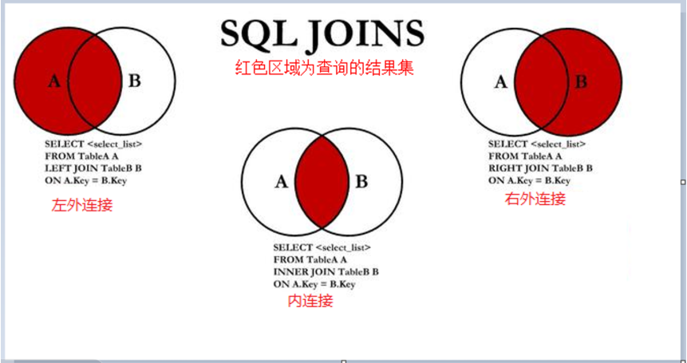

#### 5.3.1 数据准备

```
# 使用库
use my_db;
# 创建商品表
CREATE TABLE products
(
    id          INT PRIMARY KEY AUTO_INCREMENT, -- 商品ID
    name        VARCHAR(24)    NOT NULL,        -- 商品名称
    price       DECIMAL(10, 2) NOT NULL,        -- 商品价格
    score       DECIMAL(5, 2),                  -- 商品评分，可以为空
    is_self     VARCHAR(8),                     -- 是否自营
    category_id INT                             -- 商品类别ID
);
# 创建分类表
CREATE TABLE category
(
    id   INT PRIMARY KEY AUTO_INCREMENT, -- 商品类别ID
    name VARCHAR(24) NOT NULL            -- 类别名称
);

# 添加分类数据
INSERT INTO category
VALUES (1, '手机'),
       (2, '电脑'),
       (3, '美妆'),
       (4, '家居');
# 添加商品数据
INSERT INTO products
VALUES (1, '华为Mate50', 5499.00, 9.70, '自营', 1),
       (2, '荣耀80', 2399.00, 9.50, '自营', 1),
       (3, '荣耀80', 2199.00, 9.30, '非自营', 1),
       (4, '红米note 11', 999.00, 9.00, '非自营', 1),
       (5, '联想小新14', 4199.00, 9.20, '自营', 2),
       (6, '惠普战66', 4499.90, 9.30, '自营', 2),
       (7, '苹果Air13', 6198.00, 9.10, '非自营', 2),
       (8, '华为MateBook14', 5599.00, 9.30, '非自营', 2),
       (9, '兰蔻小黑瓶', 1100.00, 9.60, '自营', 3),
       (10, '雅诗兰黛粉底液', 920.00, 9.40, '自营', 3),
       (11, '阿玛尼红管405', 350.00, NULL, '非自营', 3),
       (12, '迪奥996', 330.00, 9.70, '非自营', 3),
       (13, '百草味紫皮腰果',9,NULL,NULL,NULL);
```

#### 5.3.2 交叉连接[慎用]

##### 知识点:

```
交叉连接关键字: cross join

显式交叉连接格式: select * from 左表 cross join 右表;

隐式交叉连接格式: select * from 左表,右表;

注意: 交叉连接了解即可,因为它本质就是一个错误,又叫笛卡尔积(两个表记录数的乘积)

注意: 左表和右表没有特殊含义,只是在前面是左表,在后面的是右表
```

##### 示例:

```
-- 1.交叉连接(笛卡尔积): 是一个错误!!!工作中慎用!!!
# 关键字: cross join
# 隐式交叉连接格式: select 字段名 from 左表,右表;
SELECT *
FROM
    products,
    category;
# 显式交叉连接格式: select 字段名 from 左表 cross join右表;
SELECT *
FROM
    products
        CROSS JOIN category;
```

#### 5.3.3 内连接(常用)

##### 知识点:

```
内连接关键字: inner join ... on

显式内连接格式: select * from 左表 inner join 右表 on 关联条件;

隐式内连接格式:  select * from 左表 , 右表 where 关联条件;

注意: 左表和右表没有特殊含义,只是在前面是左表,在后面的是右表
```

##### 示例:

```
-- 2.内连接: 两个表的交集
# 关键字: inner join on
# 隐式内连接格式: select 字段名 from 左表,右表 where 条件;
SELECT
    c.id   cid,
    c.name cname,
    p.id   pid,
    p.name pname
FROM
    products p,
    category c
WHERE
    p.category_id = c.id;
# 显式内连接格式: select 字段名 from 左表 cross join右表;
SELECT
    c.id   cid,
    c.name cname,
    p.id   pid,
    p.name pname
FROM
    products p
        INNER JOIN category c ON p.category_id = c.id;
```

#### 5.3.4 外连接

##### 知识点:

```
左外连接关键字: left outer join ... on
左外连接格式: select * from 左表 left outer join 右表 on 关联条件;

右外连接关键字: right outer join ... on
左外连接格式: select * from 左表 right outer join 右表 on 关联条件;

注意: 左表和右表没有特殊含义,只是在前面是左表,在后面的是右表
```

##### 示例:

```
-- 3.外连接
-- 需求: 分别使用左右连接查询每个分类下的所有商品,即使没有商品的分类要展示
-- 分析: 必须以分类表为主
-- 左外连接: left outer join
SELECT
    c.id   cid,
    c.name cname,
    p.id   pid,
    p.name pname
FROM
    category c
        LEFT OUTER JOIN products p ON p.category_id = c.id;
-- 右外连接: right outer join
SELECT
    c.id   cid,
    c.name cname,
    p.id   pid,
    p.name pname
FROM
    products p
        RIGHT OUTER JOIN category c ON p.category_id = c.id;
```

#### 5.3.5 全外连接

##### 知识点:

```
注意: mysql中没有full outer join on这个关键字,所以不能用它来完成全外连接!

mysql中实现全外连接方式: 先查询左外连接和右外连接的结果,然后用union或者union all来实现!!!
    union : 默认去重   
    union all: 不去重
```

##### 示例:

```
-- 全外连接
# union : 默认去重
SELECT *
FROM
    products p
        LEFT JOIN category c ON p.category_id = c.id
UNION
SELECT *
FROM
    products p
        RIGHT JOIN category c ON p.category_id = c.id;
```

### 5.4 自连接和子查询

#### 5.4.1 准备数据

运行脚本数据:

**右键数据库->run sql script -> areas.sql**

#### 5.4.2 自连接查询

##### 知识点:

```
自连接查询: 两个表进行关联时，如果左表和右边是同一张表，这就是自关联。

注意: 自连接必须起别名!
```

##### 示例:

```
-- 自连接查询
-- 查询'河北省'下所有城市
SELECT
    shi.id,
    shi.title,
    sheng.id,
    sheng.title
FROM
    areas sheng
        JOIN areas shi ON shi.pid = sheng.id
WHERE
    sheng.title = '河北省';


-- 查询'邯郸市'下所有的区县
SELECT
    quxian.id,
    quxian.title,
    shi.id,
    shi.title
FROM
    areas shi
        JOIN areas quxian ON quxian.pid = shi.id
WHERE
    shi.title = '邯郸市';


-- 查询'江苏省'下所有的市,以及市下面的区县信息
SELECT
    quxian.id,
    quxian.title,
    shi.id,
    shi.title,
    sheng.id,
    sheng.title
FROM
    areas sheng
        JOIN areas shi ON shi.pid = sheng.id
        JOIN areas quxian ON quxian.pid = shi.id

WHERE
    sheng.title = '河北省';
```

#### 5.4.3 子查询

##### 知识点:

```
子查询: 在一个SELECT语句中嵌入了另外一个SELECT语句那么被嵌入的 SELECT 语句称之为子查询语句

注意: 子查询是辅助主查询的。
```

##### 示例:

```
-- 子查询

--  查询'河北省'下所有城市
select * from areas where pid = (select id from areas where title = '河北省');

--  查询'邯郸市'下所有区县
select * from areas where pid = (select id from areas where title = '邯郸市');
```

## 6、拓展[了解]

### 6.1 数据库其他操作:

```
删除数据库: drop database [if exists] 数据库名;

查看当前使用的数据库: select database();

查看指定库的建库语句: show create database 数据库名;
```

### 6.2 库中表其他操作:

```
删除表: drop table [if exists] 表名;

修改表名: rename table 旧表名 to 新表名;  

查看指定表的建表语句: show create table 表名;

注意: 操作字段本质就是在修改表
添加字段:  alter table 表名 add [column] 字段名 字段类型 [字段约束];
删除字段:  alter table 表名 drop [column] 字段名;
修改字段名和字段类型:  alter table 表名 change [column] 旧字段名 新字段名 字段类型 [字段约束];
modify只修改字段类型: alter table 表名 modify [column]  字段名 字段类型 [字段约束];
查看字段信息: desc 表名;
```

