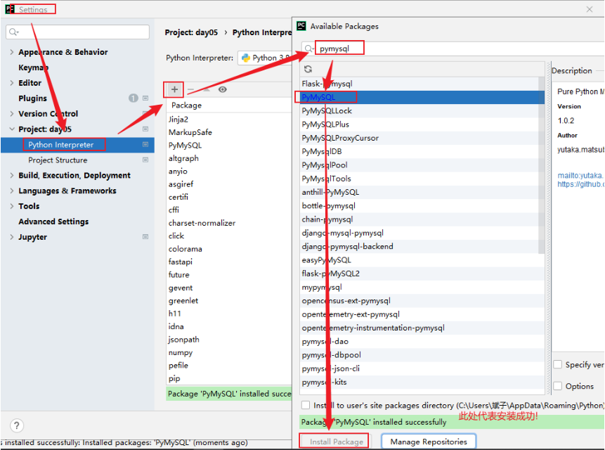
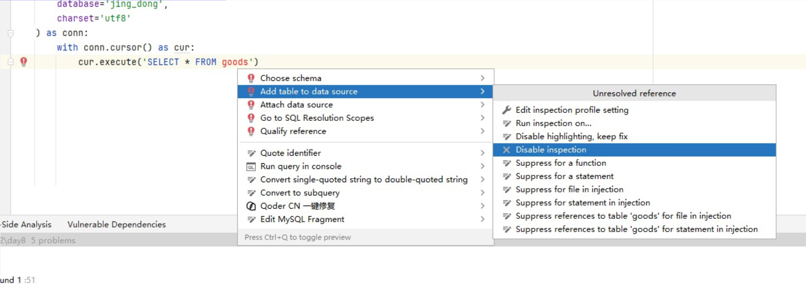
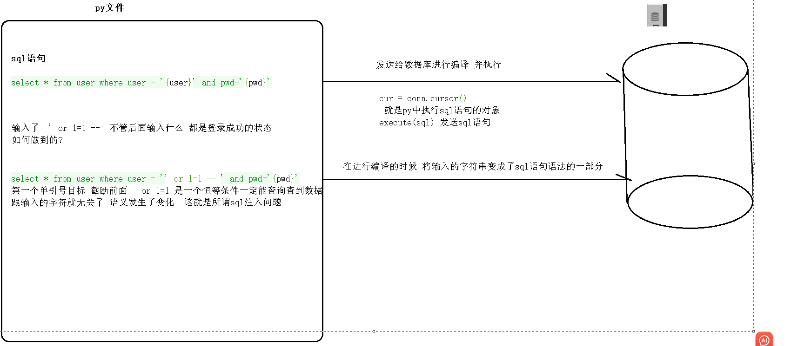
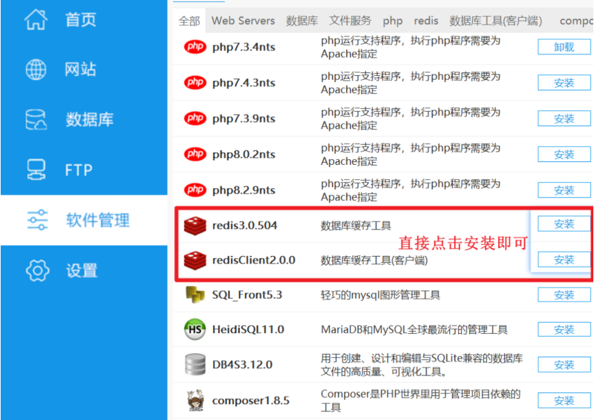
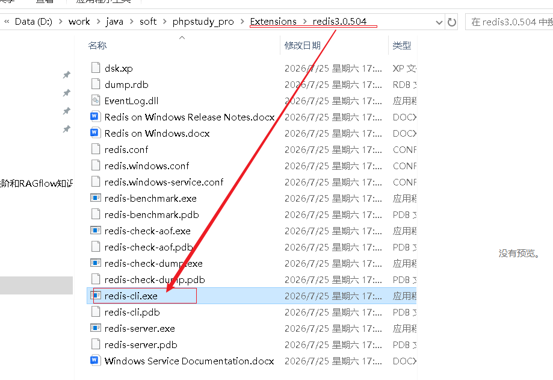

# 1 Python操作MySQL

## 1.1、为什么要学习PyMySQL

如何实现将100000条数据插入到MySQL数据库?

**答案:**

如果使用之前学习的MySQL客户端来完成这个操作，那么这个工作量无疑是巨大的，我们可以通过使用程序代码的方式去连接MySQL数据库，然后对MySQL数据库进行增删改查的方式，实现100000条数据的插入，像这样使用代码的方式操作数据库就称为数据库编程。

## 1.2、准备工作

### 1.2.1 数据准备

```
-- 创建 "京东" 数据库
create database jing_dong charset=utf8;

-- 使用 "京东" 数据库
use jing_dong;

-- 创建一个商品goods数据表
create table goods(
    id int unsigned primary key auto_increment not null,
    name varchar(150) not null,
    cate_name varchar(40) not null,
    brand_name varchar(40) not null,
    price decimal(10,3) not null default 0,
    is_show bit not null default 1,
    is_saleoff bit not null default 0
);

-- 向goods表中插入数据

insert into goods values(0,'r510vc 15.6英寸笔记本','笔记本','华硕','3399',default,default);
insert into goods values(0,'y400n 14.0英寸笔记本电脑','笔记本','联想','4999',default,default);
insert into goods values(0,'g150th 15.6英寸游戏本','游戏本','雷神','8499',default,default);
insert into goods values(0,'x550cc 15.6英寸笔记本','笔记本','华硕','2799',default,default);
insert into goods values(0,'x240 超极本','超级本','联想','4880',default,default);
insert into goods values(0,'u330p 13.3英寸超极本','超级本','联想','4299',default,default);
insert into goods values(0,'svp13226scb 触控超极本','超级本','索尼','7999',default,default);
insert into goods values(0,'ipad mini 7.9英寸平板电脑','平板电脑','苹果','1998',default,default);
insert into goods values(0,'ipad air 9.7英寸平板电脑','平板电脑','苹果','3388',default,default);
insert into goods values(0,'ipad mini 配备 retina 显示屏','平板电脑','苹果','2788',default,default);
insert into goods values(0,'ideacentre c340 20英寸一体电脑 ','台式机','联想','3499',default,default);
insert into goods values(0,'vostro 3800-r1206 台式电脑','台式机','戴尔','2899',default,default);
insert into goods values(0,'imac me086ch/a 21.5英寸一体电脑','台式机','苹果','9188',default,default);
insert into goods values(0,'at7-7414lp 台式电脑 linux ）','台式机','宏碁','3699',default,default);
insert into goods values(0,'z220sff f4f06pa工作站','服务器/工作站','惠普','4288',default,default);
insert into goods values(0,'poweredge ii服务器','服务器/工作站','戴尔','5388',default,default);
insert into goods values(0,'mac pro专业级台式电脑','服务器/工作站','苹果','28888',default,default);
insert into goods values(0,'hmz-t3w 头戴显示设备','笔记本配件','索尼','6999',default,default);
insert into goods values(0,'商务双肩背包','笔记本配件','索尼','99',default,default);
insert into goods values(0,'x3250 m4机架式服务器','服务器/工作站','ibm','6888',default,default);
insert into goods values(0,'商务双肩背包','笔记本配件','索尼','99',default,default);


# 创建用户表
create TABLE user(
    id int PRIMARY KEY AUTO_INCREMENT,
    user varchar(30),
    pwd varchar(30)
);
insert into user(user,pwd) VALUE ('root','123456');
```

### 1.2.2 安装pymysql库

确定conda环境再去安装 

```
conda env list  查看环境命令
conda activate 环境名称
```


#### 方式1

```
命令: pip  install pymysql
```

#### 方式2

```
命令: pip  install pymysql -i https://pypi.tuna.tsinghua.edu.cn/simple/ 
```

#### 方式3



## 1.3 pymysql模块使用

> pymysql是一个纯python实现的mysql客户端库,提供了python程序中操作mysql数据库的操作

### 1.3.1 核心步骤:

```
pymysql使用步骤:
1.导入模块
2.创建连接
3.创建游标
4.执行sql
5.关闭游标
6.关闭连接
```

### 1.3.2 查询操作

#### 知识点:

```
fetchone(): 一次只取一条数据
fetchall(): 一次把剩下的所有数据都取到
```

#### 示例:

```
# 1.导入pymysql模块
import pymysql

# 2.创建连接对象
conn = pymysql.connect(
    host='localhost',
    port=3306,
    user='root',
    password='root',
    database='jing_dong'
)
# 3.创建游标对象
cur = conn.cursor()
# 4.执行sql
row = cur.execute('SELECT * FROM goods')
print(f'影响了{row}行')
# fetchone: 一次拿一条数据
# data1 = cur.fetchone()
# print(data1)
# fetchall: 一次拿剩下的所有的数据
data2 = cur.fetchall()
print(data2)
# 5.关闭游标
cur.close()
# 6.关闭连接
conn.close()
```


如果goods出现报错 , 找到goods这行代码, 按键盘alt+回车 . 删除报错




### 1.3.3 增删改操作

#### 知识点:

```
拓展: 事务->要么都成功,都失败  (特性: 原子性 一致性  隔离性  持久性)

存储引擎: innodb支持事务   myisam不支持事务

增删改操作: 如果数据库底层是innodb引擎,必须手动commit提交 

数据提交:commit()
数据回滚:rollback()
```

#### 增:

```
# 1.导入pymysql模块
from pymysql import connect

# 2.创建连接对象
conn = connect(
    host='127.0.0.1',
    port=3306,
    user='root',
    password='root',
    database='jing_dong'
)
# 3.创建游标对象
cur = conn.cursor()
# 4.执行sql语句
row = cur.execute("insert into goods(name,cate_name,brand_name) value ('测试','测试','测试')")
print(f'影响了{row}行')
# innoDB引擎要求必须提交,myisam引擎不支持事务(不commit也可以)
conn.commit()
# 5.关闭游标
cur.close()
# 6.关闭连接
conn.close()
```

#### 改:

```
# 1.导入pymysql模块
from pymysql import connect

# 2.创建连接对象
conn = connect(
    host='127.0.0.1',
    port=3306,
    user='root',
    password='root',
    database='jing_dong'
)
# 3.创建游标对象
cur = conn.cursor()
# 4.执行sql语句
row = cur.execute("update goods set price = 99999 where name='测试'")
print(f'影响了{row}行')
# innoDB引擎要求必须提交,myisam引擎不支持事务(不commit也可以)
conn.commit()
# 5.关闭游标
cur.close()
# 6.关闭连接
conn.close()
```

#### 删:

```
# 1.导入pymysql模块
from pymysql import connect

# 2.创建连接对象
conn = connect(
    host='127.0.0.1',
    port=3306,
    user='root',
    password='root',
    database='jing_dong'
)
# 3.创建游标对象
cur = conn.cursor()
# 4.执行sql语句
try:
    row = cur.execute("DELETE FROM goods WHERE name='测试'")
    print(f'影响了{row}行')
    # a = 1 / 0
except Exception as e:
    print(f'老弟啊,出错了呀...详情:{e}')
    conn.rollback()

# innoDB引擎要求必须提交,myisam引擎不支持事务(不commit也可以)
conn.commit()
# 5.关闭游标
cur.close()
# 6.关闭连接
conn.close()
```

## 1.4 登录案例

> 需求: 自己创建一个数据库,里面有user表,用于存储用户名密码(咱们直接写固定 用户名root 密码123456 )
>
> 需要完成的功能是用户键盘录入用户名和密码,使用python代码连接数据库判断是否登录成功
>
> 分析: 现实生活中如果要登录,必须先注册,用户注册完后,对应的信息就存储到对应网站后台数据库中
>
> 用户登录: 用户新输入的用户名密码和数据库中的用户名和密码比较,都相同就登录成功,否则失败

### 1.4.1 建表语句

```
use jing_dong;
create TABLE user(
    id int PRIMARY KEY AUTO_INCREMENT,
    user varchar(30),
    pwd varchar(30)
);
insert into user(user,pwd) VALUE ('root','123456');
```

### 1.4.2 演示sql注入问题:

```
# 用户登录
username = input('请输入用户名:')
password = input('请输入密码:')
# 后台python代码连接数据库判断
# 1.导入pymysql模块
import pymysql
# 2.创建连接对象
conn = pymysql.connect(
    host='127.0.0.1',
    port=3306,
    user='root',
    password='root',
    database='jing_dong'
)
# 3.创建游标对象
cur = conn.cursor()
# 4.执行sql语句(判断是否登录成功)
# 下面直接传递参数的方式容易出现sql注入问题-> 用户名:随意  密码: ' or 1=1 -- 
# select * from user where user='root' and pwd='' or 1=1 or ''
row = cur.execute(f"select * from user where user='{username}' and pwd='{password}'")
if row:
    print('登录成功')
else:
    print('登录失败')
# 5.关闭游标
cur.close()
# 6.关闭连接
conn.close()
```

sql注入问题分析



### 1.4.3 解决sql注入问题

```
# 用户登录
username = input('请输入用户名:')
password = input('请输入密码:')
# 后台python代码连接数据库判断
# 1.导入pymysql模块
import pymysql
# 2.创建连接对象
conn = pymysql.connect(
    host='127.0.0.1',
    port=3306,
    user='root',
    password='root',
    database='jing_dong'
)
# 3.创建游标对象
cur = conn.cursor()
# 4.执行sql语句(判断是否登录成功)
# 解决sql注入问题:  sql单独定义,用%s占位,把所有参数放到列表里,把sql和参数列表传给execute
sql = "select * from user where user=%s and pwd=%s"
parm = [username,password]
row = cur.execute(sql,parm)
if row:
    print('登录成功')
else:
    print('登录失败')
# 5.关闭游标
cur.close()
# 6.关闭连接
conn.close()
```


# 2 非关系型数据库 Redis

## 2.1 Redis 概述

### 2.1 .1 什么是 Redis

Redis（Remote Dictionary Server）是一个开源的、基于内存的键值对存储数据库，它可以用作数据库、缓存和消息中间件。

### 2.1 .2 Redis 的特点

- **基于内存运行**：数据主要存储在内存中，读写性能极高(支持RDB-快照机制和AOF-日志机制)
- **支持数据持久化**：可以将内存中的数据保存到磁盘，重启后可以再次加载使用
- **丰富的数据类型**：支持字符串（strings）、哈希（hashes）、列表（lists）、集合（sets）、有序集合（sorted sets）等
- **支持事务**：操作都是原子性，要么全部执行，要么全部不执行
- **丰富的特性**：支持发布/订阅、键过期等特性

### 2.1 .3 Redis 的应用场景

- **缓存系统**：减轻数据库压力，提升系统性能
- **计数器**：如网站访问量、点赞数等
- **消息队列**：利用列表类型实现简单的消息队列
- **排行榜**：利用有序集合实现各种排行榜功能
- **会话存储**：存储用户会话信息

## 2.2 Redis 软件安装

### 2.2.1 Windows 系统安装

#### ☆ 方法一：使用小皮工具(推荐)



#### ☆ 方法二：使用官方版本

1. 访问 Redis 官网下载 Windows 版本
2. 解压到指定目录，如 `C:\redis`
3. 打开命令提示符，进入 Redis 目录
4. 运行命令：`redis-server.exe redis.windows.conf`

#### ☆ 方法三：使用 WSL（Windows Subsystem for Linux）

```
# 在 WSL 中安装 Redis
sudo apt update
sudo apt install redis-server

# 启动 Redis 服务
sudo service redis-server start

# 检查 Redis 状态
sudo service redis-server status
```

### 2.2.2 macOS 系统安装

#### 方式1: Homebrew

Homebrew是MacOS上的一个包管理器，它可以让安装和管理软件变得非常简单。首先，你需要安装Homebrew（如果你还没有安装的话）。

打开终端，然后粘贴以下命令来安装：

```
# 安装 Homebrew（如果尚未安装）
/bin/bash -c "$(curl -fsSL https://raw.githubusercontent.com/Homebrew/install/HEAD/install.sh)"

# 安装 Redis
brew install redis

# 启动 Redis（后台运行）
brew services start redis

# 或手动启动
redis-server /usr/local/etc/redis.conf

# 检查是否运行
# 在另一个终端窗口中，你可以使用以下命令来检查Redis服务器是否正在运行：
redis-cli ping  # 应返回 PONG,表示Redis服务器正在正常运行。
```

#### 方式2:源码编译安装

```
# 下载最新稳定版
curl -O http://download.redis.io/redis-stable.tar.gz
tar xzf redis-stable.tar.gz
cd redis-stable

# 编译
make

# 测试编译结果
make test

# 安装到 /usr/local/bin
sudo make install

# 创建配置文件目录
sudo mkdir /etc/redis
sudo cp redis.conf /etc/redis/

# 修改配置文件（可选）
vim /etc/redis/redis.conf

# 启动 Redis
redis-server /etc/redis/redis.conf
```

### 2.2.3 Linux 系统安装

#### ☆ Ubuntu/Debian 系统

```
# 更新软件包列表
sudo apt update

# 安装 Redis
sudo apt install redis-server

# 启动 Redis 服务
sudo systemctl start redis-server

# 设置开机自启
sudo systemctl enable redis-server

# 检查 Redis 状态
sudo systemctl status redis-server
```

#### ☆ CentOS/RHEL 系统

```
# 安装 EPEL 仓库
sudo yum install epel-release

# 安装 Redis
sudo yum install redis

# 启动 Redis 服务
sudo systemctl start redis

# 设置开机自启
sudo systemctl enable redis
```

### 2.2.4 验证安装

找到本机redis的安装目录



安装完成后，可以通过以下命令测试 Redis 是否正常工作：

```
# 连接 Redis 客户端
redis-cli

# 在 Redis 客户端中测试
127.0.0.1:6379> ping
PONG
127.0.0.1:6379> set test "Hello Redis"
OK
127.0.0.1:6379> get test
"Hello Redis"
127.0.0.1:6379> exit
```


# 3 Python操作Redis


非关系型数据库: 为了处理缓存

## 3.1 redis-py 模块安装

### 3.1.1 使用 pip 安装

```
# 安装 redis-py 最新版
pip install redis

# 或者指定版本  指定版本
pip install redis==4.5.0
```

### 3.1.2 使用 conda 安装

```
conda install redis-py
```

### 3.1.3 验证安装

**上述两者都指向同一个 Python 库**：`redis-py` 库在导入时都是 `import redis`

安装完成后，可以在 Python 中验证是否安装成功：

```
import redis
print(redis.__version__)
```

## 3.2 redis-py 模块使用

### 3.2.1 连接 Redis 数据库

#### ☆ 基本连接

```
import redis

# 创建 Redis 连接对象
r = redis.Redis(
	protocol=2, #　设置协议，　因为下载的版本是８版本
    host='localhost',  # Redis 服务器地址
    port=6379,         # Redis 服务器端口
    db=0,              # 数据库编号，默认0
    password=None,     # 密码，如果没有设置密码则为None
    decode_responses=True  # 自动解码，返回字符串而不是字节
)

# 测试连接
try:
    response = r.ping()
    print("Redis 连接成功:", response)
except redis.ConnectionError as e:
    print("Redis 连接失败:", e)
```

### ==3.2.2 字符串（String）操作==

#### ☆ 设置和获取值

```
import redis

r = redis.Redis(host='localhost', port=6379, db=0, decode_responses=True,protocol=2)

# 设置单个值
r.set('name', '张三')
r.set('age', '25')

# 获取单个值
name = r.get('name')
age = r.get('age')
print(f"姓名: {name}, 年龄: {age}")

# 设置多个值
r.mset({'city': '北京', 'job': '工程师'})

# 获取多个值
values = r.mget(['name', 'age', 'city', 'job'])
print("多个值:", values)

# 设置值并设置过期时间（单位：秒）
r.setex('temp_data', 60, '临时数据')  # 60秒后自动删除
```

#### ☆ 数值操作

```
import redis

r = redis.Redis(host='localhost', port=6379, db=0, decode_responses=True,protocol=2)

# 设置初始值
r.set('counter', '0')

# 自增操作
r.incr('counter')  # +1
print("自增后:", r.get('counter'))

r.incrby('counter', 5)  # +5
print("增加5后:", r.get('counter'))

# 自减操作
r.decr('counter')  # -1
print("自减后:", r.get('counter'))

r.decrby('counter', 3)  # -3
print("减少3后:", r.get('counter'))
```

### 3.2.3 哈希（Hash）操作

```
import redis

r = redis.Redis(host='localhost', port=6379, db=0, decode_responses=True,protocol=2)

# 设置哈希字段
r.hset('user:1001', 'name', '李四')
r.hset('user:1001', 'age', '30')
r.hset('user:1001', 'city', '上海')

# 获取单个字段
name = r.hget('user:1001', 'name')
print(f"用户名: {name}")

# 获取所有字段
user_info = r.hgetall('user:1001')
print("用户信息:", user_info)

# 设置多个字段
r.hmset('user:1002', {
    'name': '王五',
    'age': '28',
    'city': '广州'
})

# 获取多个字段
fields = r.hmget('user:1002', ['name', 'age'])
print("指定字段:", fields)

# 获取所有字段名
field_names = r.hkeys('user:1001')
print("字段名:", field_names)

# 获取所有字段值
field_values = r.hvals('user:1001')
print("字段值:", field_values)

# 删除字段
r.hdel('user:1001', 'city')
print("删除后:", r.hgetall('user:1001'))
```

### 3.2.4 列表（List）操作

```
import redis

r = redis.Redis(host='localhost', port=6379, db=0, decode_responses=True,protocol=2)

# 从左侧添加元素
r.lpush('tasks', 'task1', 'task2', 'task3')

# 从右侧添加元素
r.rpush('tasks', 'task4', 'task5')

# 获取列表长度
length = r.llen('tasks')
print(f"列表长度: {length}")

# 获取列表元素
all_tasks = r.lrange('tasks', 0, -1)
print("所有任务:", all_tasks)

# 获取指定范围的元素
first_three = r.lrange('tasks', 0, 2)
print("前三个任务:", first_three)

# 从左侧弹出元素
left_task = r.lpop('tasks')
print(f"左侧弹出: {left_task}")

# 从右侧弹出元素
right_task = r.rpop('tasks')
print(f"右侧弹出: {right_task}")

print("剩余任务:", r.lrange('tasks', 0, -1))
```

### 3.2.5 集合（Set）操作

```
import redis

r = redis.Redis(host='localhost', port=6379, db=0, decode_responses=True,protocol=2)

# 添加元素
r.sadd('tags', 'python', 'redis', 'database', 'cache')

# 获取所有元素
all_tags = r.smembers('tags')
print("所有标签:", all_tags)

# 判断元素是否存在
is_member = r.sismember('tags', 'python')
print("python是否存在:", is_member)

# 获取集合元素数量
tag_count = r.scard('tags')
print(f"标签数量: {tag_count}")

# 随机弹出一个元素
random_tag = r.spop('tags')
print(f"随机弹出: {random_tag}")

# 移除指定元素
r.srem('tags', 'database')
print("移除后:", r.smembers('tags'))

# 集合运算
r.sadd('set1', 'a', 'b', 'c')
r.sadd('set2', 'b', 'c', 'd')

# 交集
intersection = r.sinter('set1', 'set2')
print("交集:", intersection)

# 并集
union = r.sunion('set1', 'set2')
print("并集:", union)

# 差集
difference = r.sdiff('set1', 'set2')
print("差集:", difference)
```

### 3.2.6 有序集合（Sorted Set）操作

```
import redis

r = redis.Redis(host='localhost', port=6379, db=0, decode_responses=True,protocol=2)

# 添加带分数的元素
r.zadd('leaderboard', {
    'player1': 1000,
    'player2': 1500,
    'player3': 800,
    'player4': 2000
})

# 按分数升序获取
asc_players = r.zrange('leaderboard', 0, -1, withscores=True)
print("升序排名:", asc_players)

# 按分数降序获取
desc_players = r.zrevrange('leaderboard', 0, -1, withscores=True)
print("降序排名:", desc_players)

# 获取元素分数
score = r.zscore('leaderboard', 'player2')
print(f"player2的分数: {score}")

# 增加元素分数
r.zincrby('leaderboard', 500, 'player1')
print("增加后player1分数:", r.zscore('leaderboard', 'player1'))

# 获取排名
rank = r.zrevrank('leaderboard', 'player4')  # 从0开始的排名
print(f"player4的排名: {rank + 1}")  # 转换为从1开始的排名

# 按分数范围获取
high_scores = r.zrangebyscore('leaderboard', 1000, 3000, withscores=True)
print("高分玩家:", high_scores)
```

### 3.2.7 键操作和过期时间

```
import redis
import time

r = redis.Redis(host='localhost', port=6379, db=0, decode_responses=True,protocol=2)

# 设置键值对
r.set('session:user123', 'user_data')

# 检查键是否存在
exists = r.exists('session:user123')
print("键是否存在:", exists)

# 设置过期时间（秒）
r.expire('session:user123', 300)  # 5分钟后过期

# 获取剩余生存时间
ttl = r.ttl('session:user123')
print(f"剩余生存时间: {ttl}秒")

# 设置键值对并指定过期时间
r.setex('temp:code', 60, '123456')  # 60秒后过期

# 移除过期时间，使键永久存在
r.persist('session:user123')

# 查找匹配模式的键
all_keys = r.keys('*')
print("所有键:", all_keys)

session_keys = r.keys('session:*')
print("会话键:", session_keys)

# 删除键
r.delete('session:user123')
print("删除后是否存在:", r.exists('session:user123'))
```

## 3.3、实战案例：简单的缓存系统

```
import redis
import time
import json


class RedisCache:
    def __init__(self, host='localhost', port=6379, db=0):
        self.redis_client = redis.Redis(
            host=host,
            port=port,
            db=db,
            decode_responses=True,
            protocol=2
        )

    def set_cache(self, key, value, expire_time=3600):
        """设置缓存"""
        try:
            # 将值转换为JSON字符串存储
            value_str = json.dumps(value)
            self.redis_client.setex(key, expire_time, value_str)
            return True
        except Exception as e:
            print(f"设置缓存失败: {e}")
            return False

    def get_cache(self, key):
        """获取缓存"""
        try:
            value_str = self.redis_client.get(key)
            if value_str:
                return json.loads(value_str)
            return None
        except Exception as e:
            print(f"获取缓存失败: {e}")
            return None

    def delete_cache(self, key):
        """删除缓存"""
        try:
            self.redis_client.delete(key)
            return True
        except Exception as e:
            print(f"删除缓存失败: {e}")
            return False

    def clear_all_cache(self):
        """清空所有缓存"""
        try:
            self.redis_client.flushdb()
            return True
        except Exception as e:
            print(f"清空缓存失败: {e}")
            return False


# 使用示例
if __name__ == "__main__":
    cache = RedisCache()

    # 模拟一些需要缓存的数据
    user_data = {
        'id': 1,
        'name': '张三',
        'email': 'zhangsan@example.com',
        'last_login': '2024-01-01 10:00:00'
    }

    # 设置缓存
    cache.set_cache('user:1', user_data, expire_time=300)  # 5分钟过期

    # 获取缓存
    cached_user = cache.get_cache('user:1')
    print("缓存用户数据:", cached_user)


    # 模拟耗时操作的数据缓存
    def expensive_operation(x):
        """模拟耗时操作"""
        time.sleep(2)  # 模拟2秒的计算
        return x * x


    def get_square_with_cache(x):
        """使用缓存的平方计算"""
        cache_key = f"square:{x}"
        result = cache.get_cache(cache_key)

        if result is None:
            print(f"缓存未命中，计算 {x} 的平方...")
            result = expensive_operation(x)
            cache.set_cache(cache_key, result, expire_time=60)  # 1分钟缓存
            print("计算结果已缓存")
        else:
            print(f"缓存命中，直接返回 {x} 的平方结果")

        return result


    # 测试缓存效果
    print("\n第一次计算（会缓存结果）:")
    start_time = time.time()
    result1 = get_square_with_cache(5)
    end_time = time.time()
    print(f"结果: {result1}, 耗时: {end_time - start_time:.2f}秒")

    print("\n第二次计算（从缓存获取）:")
    start_time = time.time()
    result2 = get_square_with_cache(5)
    end_time = time.time()
    print(f"结果: {result2}, 耗时: {end_time - start_time:.2f}秒")
```