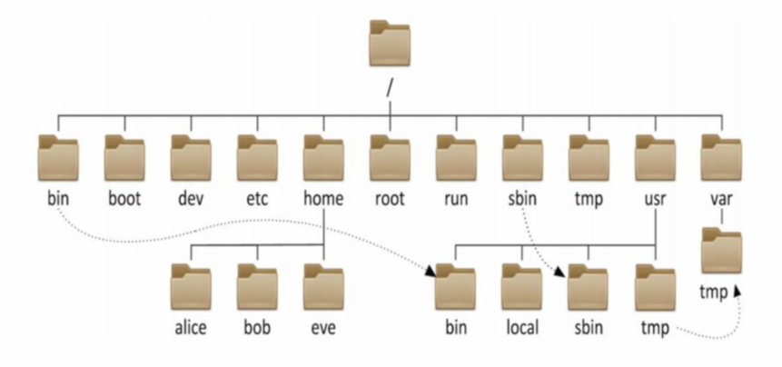
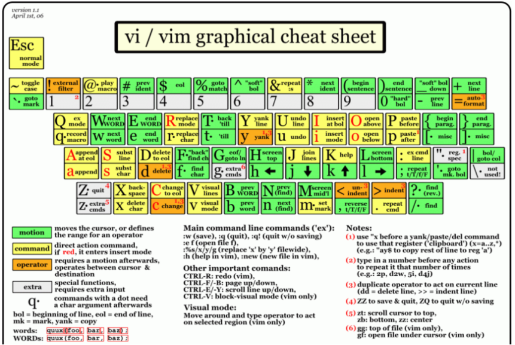
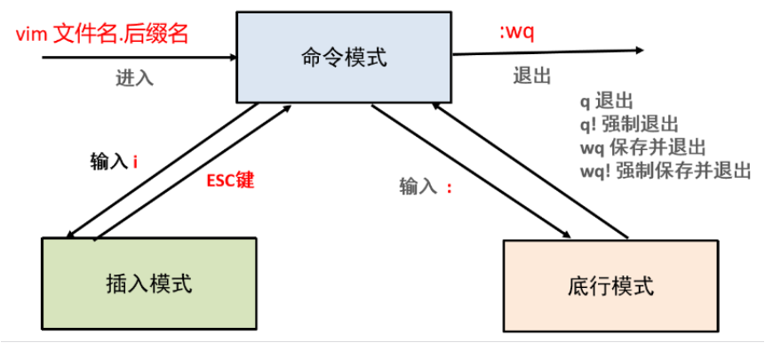
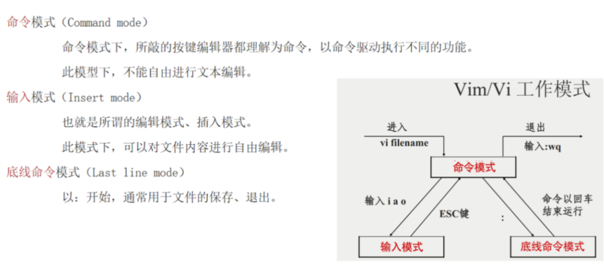
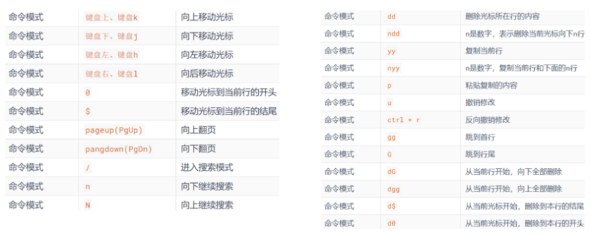
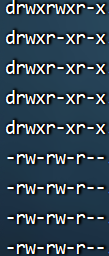
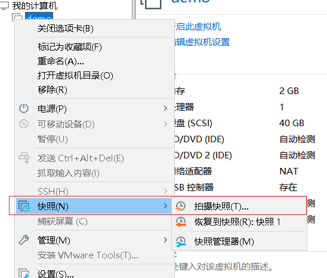
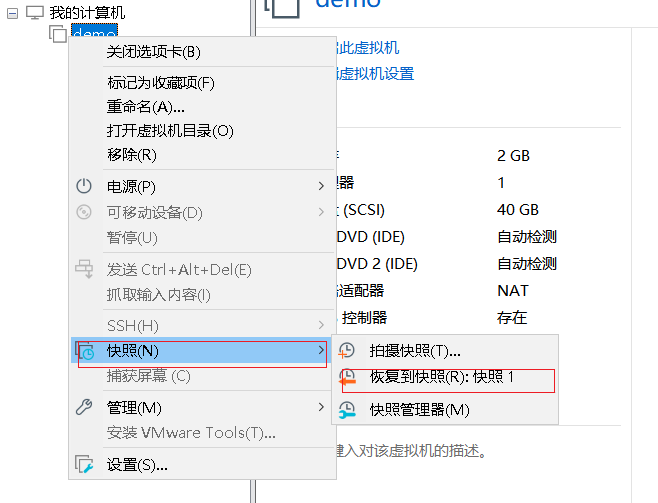

# 8.2 Linux命令

### 一、linux目录结构

```
Linux的目录结构: 是一个树型结构

Windows系统根目录:  可以拥有多个根目录, 如 C:/、D:/、E:/   举例: c:/目录1/目录2/文件

Linux系统根目录: 只有一个根目录 /, 所有文件都在它下面       举例: /目录1/目录2/文件

注意: linux绝对路径中,第一个/代表根目录,后面其他的/代表两个目录之间的间隔符    举例: /home/binzi

./ 当前目录 可省略 ../ 上一层目录

常用命令[重要!!!多用!!!]:
    cd : 切换目录位置 change directory
    pwd: 打印当前所在位置的绝对路径   
    ls : 展示当前目录下所有文件 list
    clear: 清屏   快捷键:ctrl+L

     ~ : 家目录  普通用户的家目录是:/home/普通用户名   root用户的家目录是: /root
    快速回家: cd ~  注意: ~可以省略
    两个小技巧: tab补全文件名称   history或者↑和↓能够上下翻看历史命令
```



> | 目录          | 作用                                                         |
> | :------------ | :----------------------------------------------------------- |
> | /bin          | Binaries (二进制文件) 的缩写, 这个目录存放着最经常使用的命令 |
> | /boot         | 系统引导程序所需要的文件目录，存放的是启动 Linux 时使用的一些核心文件 |
> | /dev          | Device(设备) 的缩写, 该目录下存放的是 Linux 的外部设备，磁盘，光驱 |
> | /etc          | 用来存放所有的系统管理所需要的配置文件和子目录，系统配置，启动程序 |
> | ==**/home**== | ==普通用户的家目录，在 Linux 中，每个普通用户都有一个自己的目录，一般该目录名是以用户的账号命名的== |
> | /lib          | Library(库) 的缩写这个目录里存放着系统最基本的动态连接共享库，其作用类似于 Windows 里的 DLL 文件。几乎所有的应用程序都需要用到这些共享库。 |
> | /mnt          | 临时挂载储存设备的挂载点，我们可以将光驱挂载在 /mnt/ 上，然后进入该目录就可以查看光驱里的内容了 |
> | /opt          | optional(可选) 的缩写，这是给主机额外安装软件所摆放的目录。比如你安装一个MySQL数据库则就可以放到这个目录下。默认是空的。 |
> | /proc         | 存储的是当前内核运行状态的一系列特殊文件。操作系统运行时，进程信息和内核信息存放在这里。 |
> | ==**/root**== | ==Linux超级权限用户root的家目录==                            |
> | /sbin         | 管理系统相关的命令【超级管理员用】                           |
> | /tmp          | 临时文件目录，这个目录被当作回收站使用                       |
> | /usr          | 用户或系统软件应用程序目录，类似于 windows 下的 program files 目录。 |


### 二、linux命令

#### 1 linux命令格式

```
command [-options] [parameter]

说明:
- command : 命令名, 相应功能的英文单词或单词的缩写
- [-options] : 选项, 可用来对命令进行控制, 也可以省略
- parameter  : 传给命令的参数, 可以是 零个、一个 或者 多个
```

#### 2 基础四大命令

```
ls: 查看当前目录了下所有内容 ll    
cd 目录名: 切换目录
pwd: 查看当前所在位置
clear: 清屏
./  当前目录
../  上一层目录
```

#### 3 ls和cd和pwd和clear命令

```
ls [-a -l -h] [路径] : 查看指定路径下文件列表  注意: 默认都是当前路径
    参数 -a : 展示出隐藏文件              注意: .开头就是隐藏文件
    参数 -l : 以详细信息展示文件           注意: ls -l 可以简化为ll
    参数 -h : 配合-l使用,人性化展示文件大小 


cd [路径] : 切换到指定路径下
    家目录: 普通用户的家目录:/home/普通用户名     root用户的家目录:/root       
    如何快速回家: cd ~    注意: ~可以省略


pwd : 查看当前路径 


clear:  清屏       快捷键: ctrl+L
```

#### 4 相对路径和绝对路径

```
1. 相对路径和绝对路径
绝对路径: 以根目录'/'做起点，描述路径的方式，路径以/开头
相对路径: 以当前目录做起点，描述路径的方式，路径不需以/开头 ./
如无特殊需求，后续学习中，将经常使用相对路径表示

2. 特殊路径符有哪些？
.  表示当前目录，  比如:  cd .    或 cd ./Desktop
.. 表示上一级目录，比如: cd ..  或 cd ../..
```

#### 5 帮助手册[掌握][¶]

```
help查看帮助: 命令 --help       解释:会列出命令的帮助文档   
    举例: ls --help

man查看手册:  man  命令         解释: man（manual， 手册）命令查看详细手册
    举例: man ls
```

#### 6 mkdir和touch命令

创建文件夹 和 文件

```
mkdir [-p] 目录路径 : 创建指定目录   
    -p:可选，表示自动创建不存在的父目录，适用于创建连续多层级的目录
    创建一级目录: mkdir 目录路径
    创建多个同级目录: mkdir 目录路径1  目录路径2 ...
    创建父子嵌套目录: mkdir -p 目录路径1/目录路径2/...

touch 文件路径: 创建指定文件(一般不用 使用vim)
    创建一个文件: touch 文件路径
    创建多个文件: touch 文件路径1  文件路径2 ...
```

#### 7 cat和more命令

```
cat [-n] 文件 :  cat查看文件内容,一般建议查看小文件
          -n :显示行号


less 
	-M:  百分比
	空格: 下一页
    回车: 一行
    b  : 上一页
    q  : 退出
    -N : 行号
```

#### 8 head和tail

tail 实时查看日志文件  tail - f 循环读取文件

```
head [-num] 文件路径:  查看文件的头部几行   默认前10行   当然-num可以指定任意行数

tail [-num] 文件路径:  查看文件的尾部几行   默认后10行   当然-num可以指定任意行数
```

#### 9 cp和mv和rm命令

> 复制的英文单词: copy    
>
> cp  文件 路径     单纯复制
>
> cp  文件 路径/文件名称.后缀    复制并改名

```
cp [-r] 要复制的文件或者文件夹  目标位置    : 复制文件或者文件夹到指定目标位置

    注意: -r 主要用于复制文件夹  递归复制

    注意: cp复制文件后,源文件依然存在
```

> 移动的英文单词: move  相当于剪切

```
mv 要移动的文件或者文件夹  目标位置: 移动文件或者文件夹到指定目标位置

    注意: 目标位置是文件,文件不存在就会直接改名    如果想要把文件移动到目录中,此目录一定要存在,否则当成了普通文件改名

    注意: mv移动文件后,源文件不存在
```

> 移除的英文单词: remove

```
rm [-r -f] 要删除的文件或者文件夹:  删除指定的文件或者文件夹

    注意: -r 主要用于删除文件夹        -f :主要用于强制删除文件或者文件夹
    rm -fr 强制删除
```

#### 10 echo和重定向命令

```
echo: 默认打印到控制台,但是经常配合重定向符号使用
    示例：echo 要打印的内容

> : 覆盖写入
>> : 追加写入

注意: 重定向符号经常和echo一起使用
    示例： echo ‘hello’ >> h.txt
```

#### 11 tar命令

> tar命令参数如下：
>
> -c，创建压缩文件，用于压缩模式
>
>  -v，显示压缩、解压过程，用于查看进度 
>
> -x，解压模式 
>
> -f，要创建的文件，或要解压的文件，
>
> -f选项必须在所有选项中位置处于最后一个 
>
> -z，gzip模式，不使用-z就是普通的tarball格式 -C，选择解压的目的地，用于解压模式

```
普通打包格式: tar -cvf 包名.tar 多个文件或者目录
普通解包格式: tar -xvf 包名.tar -C 目标位置路径

gzip压缩格式:  tar -zcvf 包名.tar.gz 多个文件或者目录
gzip解压格式:  tar -zxvf 包名.tar.gz -C 目标位置路径
```

#### 12 常用指令

```markdown
查找文件 find 路径 -name 文件名称              \*表示匹配符
任务管理器 ps -ef | grep -i 搜索进程
ping 127.0.0.1 > ip.log &        &符号让这行命令在后台运行
杀死进程 kill -9 pid 
```


### 三、VI编辑器



#### 1 VI和VIM概述

vi相当于 我们的windows记事本

vim 相当于 window下的 notepad++

```
vi: 是visual interface的简称, 是Linux中最经典的文本编辑器

vim:  编辑器是从vi发展出来的文本编辑器, 支持代码补全、编译及显示效果等方面编程的功能提别丰富, 在程序员中被广泛使用, 被称为编辑器之神。

查看文件内容:  cat 文件
修改文件内容:  vi 文件 或者 vim 文件
```



#### 2 VI编辑器三种模式

```
打开文件: vim 文件名.后缀名     注意: 如果文件存在就打开,不存在就创建

编辑文件: 输入i进入文件进行编辑

保存文件:
1.先进入命令模式: 按ESC键  
2.进入底线命令模式: 输入冒号:   
3.输入命令: w(保存)  q(退出)  q!(强制退出)  wq(保存并退出)   wq!(强制保存并退出)
```



#### 3 入门案例:

> 使用vi编辑器,创建一个名称为hello.py文件,然后输入内容为: print('hello ai大模型'),最后wq保存
>
> 注意: 如果文件不存在,不会报错,会自动创建,编辑完内容后手动输入:wq保存即可
>
> 要求保存后再次使用vim命令查看内容是否保存成功,然后q退出

```
[root@localhost ~]# vi hello.py
# 输入i进入插入模式: 编写或者粘贴内容
print('hello ai大模型')
# 内容输入完后,按ESC退出到命令模式
...
# 然后在命令模式输入:wq保存并退出
:wq
"hello.py" 1L, 23C written

[root@localhost ~]# vim hello.py
[root@localhost ~]# 
```

#### 4 典型应用: 修改固定ip

> 默认虚拟机的ip地址是dhcp自动分配的,如果每天变化,影响工作效率,大家可以把虚拟机的ip地址设置为固定

把虚拟机的ip地区修改为固定ip?

```
[root@node1 /]# vim /etc/sysconfig/network-scripts/ifcfg-ens33
```

> ```
> TYPE="Ethernet"
> PROXY_METHOD="none"
> BROWSER_ONLY="no"
> -- 1.把下面一行的dhcp修改成static
> BOOTPROTO="static"
> DEFROUTE="yes"
> IPV4_FAILURE_FATAL="no"
> IPV6INIT="yes"
> IPV6_AUTOCONF="yes"
> IPV6_DEFROUTE="yes"
> IPV6_FAILURE_FATAL="no"
> IPV6_ADDR_GEN_MODE="stable-privacy"
> NAME="ens33"
> UUID="dfd8991d-799e-46b2-aaf0-ed2c95098d58"
> DEVICE="ens33"
> ONBOOT="yes"
> -- 2.添加以下内容到文件末尾,下面第一个就是固定ip地址,当然也可以自定义
> IPADDR="192.168.88.3"
> NETMASK="255.255.255.0"
> GATEWAY="192.168.88.2"
> DNS1="8.8.8.8"
> DNS2="114.114.114.114"
> IPV6_PRIVACY="no"
> ```

网络服务(关闭启动重启)

> 二选一

```
旧版命令
[root@node1 ~]# service network restart
新版命令
[root@node1 ~]# systemctl restart network
```

注意: 如果修改的固定ip不是原来客户端连接的ip,那就需要重新用crt或者finalshell重新连接

查看ip地址

```
[root@node1 /]# ifconfig
```

#### 5 VIM其他命令





### 扩展-了解 四:权限操作



```markdown
通过ll命令查看后能 看到每一个文件前面对应一组特殊符号  
第1位表示 文件或文件夹    d表示文件夹  -表示文件  l 链接文件 快捷方式
第2-4位表示 用户  user
第5-7位表示 用户的组 group 
第8-10位表示 其他  other
除了第一位外 后续每三位一组 分别表示 rwx  可读 可写 可执行 权限
我们通过chmod 可以修改用户的权限 
第一种方案: change mode
	chmod u+rwx 文件名称
	chmod g+rwx 文件名称
	chmod o+rwx 文件名称
	chmod u-rwx 文件名称
	chmod g-rwx 文件名称
	chmod o-rwx 文件名称
第二种方案:
	chmod u=rwx 文件名称
	chmod g=rwx 文件名称
	chmod o=rwx 文件名称
第三种方案:
	chomd 777 文件名称
每一组rwx表示  r=4  2的2次方  w=2  2的1次方   x=1  2的0次方   需要什么权限进行设置即可
例如: 
	chmod 652 文件名称 
	最后的结果为:    rw-r-x-w-
	一般情况下 777
```


### 扩展-了解 五:备份还原






